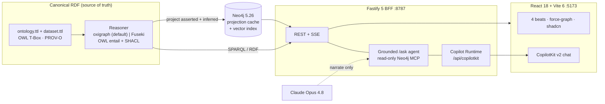

<div align="center">

# R&D Trust Graph

**A graph that reasons; an LLM that only narrates.**
An offline-capable knowledge-graph demo for pharmaceutical R&D and pharmacovigilance.


[Quick start](#-quick-start) · [Features](#-feature-tour) · [Architecture](#-architecture) · [Runtime & operations](#-runtime--operations) · [Endpoints](#-http-endpoints) · [Honest scope](#-honest-scope)

<sub>Live status &amp; per-change verification: <a href="BUILD_STATUS.md">BUILD_STATUS.md</a><br/>295 BFF tests passing, 32 skipped (they need a live Neo4j), typecheck + build green — verified from a clean clone, 2026-10-13</sub>

</div>

---

One Neo4j knowledge graph fronted by a W3C RDF/SPARQL reasoner, four interactive "beats", and a governed grounded chat. The thesis is **structural, not narrative**: a reasoner *derives and validates* conclusions (OWL entailment + SHACL), the property graph is a fast projection cache, and the LLM is kept off the critical path — it narrates over a server-side allow-list and **refuses** anything it can't ground.

> [!IMPORTANT]
> **Grounding is enforced in code, not in a prompt.** Off-path citations are refused (`validateGrounding`), out-of-graph questions return `NOT_IN_GRAPH` (and **draw nothing**), the Neo4j MCP is read-only, and no raw API key lives in the BFF. A prompt or admin edit *cannot* weaken any of this — the guarantees sit outside the editable config.

## ✨ Feature tour

### The four beats

| # | Beat | What it proves | How it's real |
|---|------|----------------|---------------|
| 1 | **FAIR Data-Readiness Radar** | The door-opener: data silos & readiness at a glance | Colours/ring-thickness/on-node number encode live ALCOA+/FAIR completeness; flags come from **live SHACL** validation |
| 2 | **PV Signal-Causality Explanation Path** *(hero)* | *"You need a graph, not just a vector DB"* | A deterministic multi-hop chain revealed node-by-node back to source evidence; the mechanistic hop is an **OWL property-chain entailment** (`CANDIDATE_SIGNAL ← TARGETS ∘ IN_PATHWAY`) with an inference trace |
| 3 | **Multimodal resolve** | Pathology image / omics → the concept the graph already reasons over | A pre-computed 384-dim embedding resolves via the **Neo4j native vector index** to the ontology concept on the hero path |
| 4 | **Ask-the-graph conversation** | A grounded analyst, not a chatbot | **CopilotKit v2 Copilot Runtime** over the read-only `/ask` agent; shows its real Cypher, cites nodes, persists threads, and routes statistical conclusions to **human review** |

### Data-quality radar (Beat 1) — *doc use-case #4*

The "easiest to sell" PoC: find where unsafe data **relationships** (not field errors) could undermine downstream AI/analytics — and route each to an owner.

- **SHACL-grounded flags** — seven risk types (`missing-provenance`, `conflicting-annotation`, `missing-cross-source-link`, `stale-ontology-version`, `dangling-reference`, `duplicate-record`, `missing-followup` / "referral without follow-up"). Each flag is a **live SHACL violation**, never a hand-rolled heuristic.
- **Why-flagged evidence path** — every row carries the real SHACL `sh:resultMessage` + the violated shape + expected-vs-actual, surfaced in the radar *and* the provenance drawer's "Why was this flagged?" block.
- **Severity + remediation owner** — a TOTAL `RISK_POLICY` map routes each flag to a P0/P1/P2 band and an accountable role (Data steward / PV signal lead / Ontology steward / Bioinformatics lead). A type-level test fails if any flag lacks an entry.
- **HITL decision cockpit + audit trail** — Approve / Reject / Escalate per finding, written through the authorized Neo4j `write()` path to a **reversible change-set log** (`/api/hitl/*`), shown back as "Reviewed by" on the node.

### Trust & reasoning layer

- **RDF-first core** — canonical Turtle (OWL T-Box + PROV-O data) is the source of truth; the reasoner loads, entails to fixpoint, and validates. Neo4j is a **projection cache** for fast viz + traversal.
- **Toggleable reasoner backend** — `oxigraph` (in-process WASM SPARQL 1.1 + `shacl-engine`, **default, zero sidecar**) or Apache Jena **Fuseki** (Docker sidecar) — switch via `REASONER_BACKEND` or the admin config; cross-backend parity is verified.
- **Read-only SPARQL endpoint** (`POST /api/sparql`) — `INSERT`/`DELETE`/`UPDATE` rejected.
- **Enforced grounding & principled refusal** — narration returns `{narration, citedNodeIds}` validated against the path; `/ask` streams the **actual read-only Cypher + returned rows** ("show your work") and refuses out-of-graph questions.

### Grounded conversation (Beat 4, CopilotKit v2)

- **Full Copilot Runtime** transport (`/api/copilotkit/*`) — a transparent AG-UI proxy to the untouched grounded agent; **no second LLM, no Runtime API key**.
- **Thread persistence (shared with the dock)** — conversations are saved, switchable, and restored across reload. The full Beat-4 surface **and** the floating AskDock bind to the **same** persistent thread (one shared `localStorage` key + the history-only BFF store), so a chat started in the dock is still there when you **⤢ expand** to the full conversation page — and vice versa. Persisted history is messages + per-turn grounding only; it never touches Neo4j.
- **Static grounded suggestions** — four starter prompts (no dynamic/model-backed suggestions, which would be a second ungrounded path).
- **Readable context** — graph schema/legend exposed as metadata only ("not a source of facts — read the live graph").
- **Human-in-the-loop governance** — when an answer leans on a *statistical* (`routedToHuman`) conclusion, an in-thread ⚖ **Approve / Reject / Escalate** card appears; deductive/refused answers raise none.
- **Generative grounded diagrams** — cited-node force-graph + Recharts PRR/ROR chart + Mermaid hero flow, all derived from real returned rows; unknown ids dropped, nothing fabricated. Each figure is **zoomable** (inline −/reset/+) with an **expand-to-fullscreen** lightbox — pure view affordances, no new fetch.
- **Known / Missing / Conflicting answer shape** *(doc use-case #2 "wow")* — an `EvidenceLedger` buckets the *real cited nodes* into known / data-gap / conflicting, with an explicit **confidence boundary** ("answer bounded to N cited node(s); off-graph refused"). Never invents a gap.
- **Multi-node context (click accumulates)** — click several canvas nodes to gather them as shared context; relational pills (Connections / Shared evidence / Compare known-missing) submit one grounded turn naming all of them. Available in the full chat **and** the floating AskDock.
- **Scrollable, switchable history** — the conversation surface is viewport-bounded, so the thread list scrolls internally; selecting an older thread restores it into the chat window.

### Chrome, provenance & operations

- **Provenance drawer** — per-node ALCOA+ / 21 CFR Part 11 drill-to-source on click.
- **Live Admin config panel** — hot-applies editable prompts, the refusal marker, and risk thresholds **with no restart**; a read-only `enforced` block shows what's locked.
- **App-wide shadcn/ui design system** — one unified OKLCH token set + Tailwind v4; controls are shadcn primitives. Two-axis live theming: **skin** (war-room ↔ boardroom) and **density** (comfortable ↔ compact), persisted to `localStorage`, plus a **light-canvas** projector toggle and `prefers-reduced-motion` support.
- **FinOps meter** — a header pill shows live token spend & cost (`/api/finops/summary`), turning amber/red against the configured budget; the full ledger is at `/api/finops/ledger`. Read-only observability — it never gates the LLM.
- **Reviewer notifications (ReviewBell)** — a header bell badges the count of items routed to a human (`/api/hitl/pending`) and opens the queue.
- **W3C/RDF export** — download the live hero subgraph as Turtle from the header.
- **Scripted ↔ Live modes** — a recorded fallback so it **never fails on stage**.

## 🗺️ Architecture



**Stack:** TypeScript end-to-end · Node ≥20 · Neo4j 5.26 (Docker) · Fastify 5 BFF · React 18 + Vite 6 (`react-force-graph-2d`, CopilotKit v2, shadcn/ui, Tailwind v4) · `@anthropic-ai/claude-agent-sdk` · `oxigraph` (WASM) / Apache Jena Fuseki reasoner.

## 🚀 Quick start

```bash
cp .env.example .env            # set NEO4J_PASSWORD; copy to bff/.env too
npm install                     # installs all workspaces (shared, bff, web)
npm run db:up                   # start local Neo4j (offline after first image pull)
npm run rdf                     # generate canonical RDF + verify it (rdf:generate && rdf:verify)
npm run etl                     # RDF → reason → project to Neo4j + vector index
npm run dev                     # BFF (:8787) + web (:5173), concurrently
```

Open **http://localhost:5173**. Keep **http://localhost:7474** (Neo4j Browser) in a tab for the "is it a real graph?" cutaway.

> [!TIP]
> The demo runs fully **offline/scripted** with no API key. For live LLM narration + ask, set `LLM_PROVIDER=claude-code` in `bff/.env` and sign in once with the local `claude` CLI — auth rides on your Claude Code subscription, so no key sits in the BFF. Check readiness any time with `GET /api/diag` (also shown as the header pill).

## ⚙️ Runtime & operations

### Prerequisites

| Requirement | Needed for | Notes |
|---|---|---|
| **Node ≥ 20** | everything | npm workspaces |
| **Docker** | Neo4j (and optional Fuseki) | `npm run db:up` |
| **`claude` CLI** (logged in) | live mode via `LLM_PROVIDER=claude-code` | subscription auth, no API key |
| **`uvx`** (from `uv`) | the read-only Neo4j MCP in `/ask` | spawns `mcp-neo4j-cypher@0.6.0` |
| `ANTHROPIC_API_KEY` | live mode via `LLM_PROVIDER=api` | optional; blank = scripted-only |

### LLM transport — selected by `LLM_PROVIDER`

| Value | What it does | Auth |
|---|---|---|
| `api` | Cloud Claude Messages API / Agent SDK | needs `ANTHROPIC_API_KEY` (blank ⇒ scripted/cached only) |
| `claude-code` | Spawns your **local `claude` CLI** | Claude Code subscription login — **no key in the BFF** |

Narration (`/narrate`, one-shot) and ask (`/ask`, multi-turn tool-loop) have **independent** models & timeouts (`NARRATE_*` vs `ASK_*`), so a cheaper narration model never touches ask quality.

### Reasoner backend — selected by `REASONER_BACKEND`

| Value | Backend | Trade-off |
|---|---|---|
| `oxigraph` *(default)* | In-process WASM SPARQL + `shacl-engine` | zero sidecar, portable, full SHACL |
| `fuseki` | Apache Jena Fuseki (Docker) | production-grade; set `FUSEKI_URL` (+ optional `FUSEKI_USER`/`FUSEKI_PASSWORD`) |

### Ports

| Port | Service |
|---|---|
| `5173` | Web app (Vite) — proxies `/api` → 8787 |
| `8787` | BFF (Fastify) |
| `7474` / `7687` | Neo4j Browser / Bolt |
| `3030` | Fuseki (only when `REASONER_BACKEND=fuseki`) |

### Scripts

| Command | Does |
|---|---|
| `npm run dev` | BFF (`tsx watch`) + web (Vite) together |
| `npm run db:up` / `db:down` / `db:logs` | local Neo4j lifecycle |
| `npm run rdf` *(in `bff`)* | generate canonical RDF then verify (`rdf:generate` + `rdf:verify`) |
| `npm run etl` | RDF → reason → project into Neo4j + seed vector index (idempotent) |
| `npm run typecheck` | all workspaces |
| `npm test -w bff` | BFF suite (`node --import tsx --test`, per-worker config isolation) |
| `npm run build` | all workspaces |

<details>
<summary><strong>Verify the build (full gate)</strong></summary>

```bash
npm run typecheck               # all workspaces
npm test            -w bff      # BFF suite (grounding invariants: hero 3 hops,
                                #   AE-MYOCARDITIS ≥6 cases, exactly 4 noise nodes)
cd bff && npm run rdf:verify    # SHACL conformance + entailment + hero-3-hop
npm run build                   # all workspaces
```

Grounding invariants are asserted in the suite and survive **both** reasoner backends. If `/ask` shows a fallback badge, read the badge reason / `GET /api/diag` — it's a config/prereq signal, not "broken".

</details>

## 🔌 HTTP endpoints

| Method | Route | Purpose |
|---|---|---|
| `GET` | `/api/health`, `/api/diag` | health + live-readiness (transport, model, MCP, reasoner) |
| `GET` | `/api/graph?scope=hero\|all` | graph payload for the canvas |
| `GET` | `/api/explain` | the deterministic hero explanation path |
| `GET` | `/api/rdf` | canonical store as Turtle (export) |
| `POST` | `/api/sparql` | **read-only** SPARQL (mutations rejected) |
| `GET` | `/api/provenance/:id` | per-node ALCOA+ provenance |
| `POST` | `/api/narrate` | grounded narration (SSE), cited + validated |
| `POST` | `/api/ask` | grounded ask-anything (SSE) — Cypher + rows + answer/refusal |
| `POST` | `/api/agui` | AG-UI bridge to the grounded agent |
| `*` | `/api/copilotkit/*` | CopilotKit v2 Copilot Runtime |
| `GET/POST/PUT/DELETE` | `/api/threads[/:id]` | Conversation persistence (history only — messages + grounding, in `bff/threads.json`); **shared by Beat 4 and the floating AskDock** |
| `GET/POST` | `/api/hitl/{pending,apply,revert,changesets,flag}` | HITL review actions + manual reviewer **flag** + reversible change-set audit log (authorized `write()` path) |
| `GET` | `/api/risk` | Beat-1 radar findings (SHACL-grounded flags + why-flagged reasons) |
| `GET` | `/api/finops/{summary,ledger}` | token/cost observability (read-only ledger; never gates the LLM) |
| `GET` | `/api/eval/summary` | answer-quality scorecard — faithfulness (F1) + context-recall + relevancy (F2), read-only |
| `GET/PUT` | `/api/admin/config` | hot-apply editable prompts/marker/thresholds **(no restart)** (+ read-only `enforced` block) |
| `GET` | `/api/config/public`, `/api/terminology`, `/api/gated`, `/api/resolve*` | supporting reads |

## 🎬 Demo modes

- **Scripted** (default): rehearsed auto-advance, cached narration — bulletproof, no network needed.
- **Live**: real Opus 4.8 narration + ask-anything; falls back to cached content within the configured timeout if the room has no wifi.

If anything wobbles on stage, see [`RUNBOOK.md`](RUNBOOK.md) — rehearsed handoff to the recorded fallback.

## 🔭 Honest scope

> [!NOTE]
> Synthetic, PHI-free data; commercial-safe sources only (CC-BY / CC0 / public-domain / Apache-2.0) — **real** public IDs, **synthetic** summaries. This demonstrates **capability**, not epidemiological validity or a production PV system, and is deliberately **not** a patient-specific clinical alert (that pattern leans FDA-device).

**Real today:** RDF-first reasoning (OWL entailment + live SHACL, two backends), Neo4j projection cache + vector resolve, enforced grounding + refusal, the full Copilot Runtime (threads, suggestions, readable, HITL), generative grounded diagrams, hot-apply admin, app-wide shadcn design system.

**Scoped out / cameo:** production identity & multi-tenant auth, large-scale ingestion/ETL ops, and clinical validation. The demo-stage simplifications below are the honest list; none of them are hidden behind a happy path.

> [!NOTE]
> **Demo-stage simplifications** (deliberate, and resolved in the target-state architecture — none weaken the trust thesis):
> - The Neo4j projection **re-reads the source CSVs**, so RDF is **not byte-canonical** for node `attrs` / edge provenance. RDF stays source-of-truth for **topology + reasoning**; the projection layer re-derives some attributes.
> - `CANDIDATE_SIGNAL` is a single-pass SPARQL `INSERT…WHERE` rule (the `TARGETS ∘ IN_PATHWAY` property chain), **not** a full OWL reasoning engine.
> - `IN_PATHWAY` transitivity is **declared** in the ontology but **not operationally entailed** — no transitive closure is materialized at query time.

---

<div align="center"><sub>The graph reasons, the LLM narrates.</sub></div>
