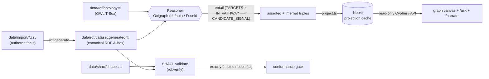

# Data Preparation Guide

How to author, generate, reason over, validate, and persist data for the **R&D Trust Graph** demo. This repo is **RDF-first**: facts are authored as CSV, generated into RDF (Turtle), reasoned over (OWL-style entailment) and SHACL-validated by an in-process reasoner, then **projected into Neo4j as a read-only cache** for the graph canvas and Cypher.

> [!NOTE]
> The canonical source of truth is **RDF**, not Neo4j. Neo4j is a projection cache that is rebuilt from the RDF on every ETL run. Author data in the CSVs — never hand-edit [`data/rdf/dataset.generated.ttl`](../data/rdf/dataset.generated.ttl) (it carries a `DO NOT EDIT BY HAND` banner and is regenerated from the CSVs every run).

## Pipeline at a glance



| Stage | Command | Code | Output |
|-------|---------|------|--------|
| Author | _(edit by hand)_ | [`data/import/*.csv`](../data/import) | CSV rows |
| Generate RDF | `npm run rdf:generate` | [`bff/src/etl/rdf/generate.ts`](../bff/src/etl/rdf/generate.ts) | `dataset.generated.ttl` |
| Verify (reason + SHACL) | `npm run rdf:verify` | [`bff/src/etl/rdf/verify.mjs`](../bff/src/etl/rdf/verify.mjs) | PASS/FAIL assertions |
| Generate **and** verify | `npm run rdf` | both of the above | — |
| Project to Neo4j | `npm run etl` | [`bff/src/etl/run.ts`](../bff/src/etl/run.ts) → [`project.ts`](../bff/src/etl/project.ts) | populated Neo4j |

---

## 1. Data model

The ontology ([`data/rdf/ontology.ttl`](../data/rdf/ontology.ttl)) is the OWL **T-Box**. Everything lives in one namespace, `rtg: <https://vinayagrw.github.io/rnd-trust-graph#>`, and **object-property IRIs are `UPPER_SNAKE` — identical to the Neo4j relationship types**, so the triplestore and the serving cache speak one vocabulary.

### Node kinds (classes)

All node classes are subclasses of `rtg:GraphNode`, which bears the ALCOA+ provenance obligation. The CSV `kind` column **is** the class local name **is** the Neo4j label (identity map).

| Group (`subClassOf GraphNode`) | Concrete class (`kind` / Neo4j label) | Meaning |
|--------------------------------|---------------------------------------|---------|
| `ClinicalEntity` | `AdverseEvent` | Coded adverse drug reaction (OAE / MedDRA) |
| `ClinicalEntity` | `Patient` | Synthetic (Synthea) subject, **PHI-free** |
| `MechanisticEntity` | `Drug` | Pharmacological agent (RxNorm / ChEMBL) |
| `MechanisticEntity` | `BiologicalTarget` | Molecular target (UniProt) |
| `MechanisticEntity` | `Pathway` | Biological pathway (Reactome / WikiPathways) |
| `EvidenceEntity` | `SignalStat` | Disproportionality stats (PRR/ROR/chi²) |
| `EvidenceEntity` | `Evidence` | Aggregate evidence record (FAERS / citation) |
| `EvidenceEntity` | `LiteratureAbstract` | PubMed/PMC abstract (synthetic summary, real PMID) |
| `EvidenceEntity` | `ClinicalTrial` | ClinicalTrials.gov study (real NCT id) |
| `EvidenceEntity` | `RegulatoryDoc` | FDA label / EMA excerpt (synthetic text, real app no.) |
| `EvidenceEntity` | `GeneticAssociation` | Open Targets-style association (Ensembl gene id) |
| `ModalityEntity` | `PathologyImage` | Whole-slide image (synthetic) |
| `ModalityEntity` | `OmicsProfile` | Omics signature, e.g. RNA-seq (synthetic) |
| `TerminologyEntity` | `Concept` | Ontology / UMLS-style concept (MONDO / GO) |
| `TerminologyEntity` | `OntologySlice` | Dated ontology release |

### Relationship / edge types (object properties)

| Property (= edge `type` = Neo4j rel type) | Domain → Range | Notes |
|-------------------------------------------|----------------|-------|
| `REPORTS` | `Patient` → `AdverseEvent` | |
| `SUSPECTED_IN` | `AdverseEvent` → `Drug` | |
| `TARGETS` | `Drug` → `BiologicalTarget` | feeds the candidate-signal chain |
| `IN_PATHWAY` | `BiologicalTarget` → `Pathway` | **transitive** (`owl:TransitiveProperty`) |
| `HAS_STAT` | `AdverseEvent` → `SignalStat` | |
| `SUPPORTED_BY` | `SignalStat` → `EvidenceEntity` | |
| `RESOLVES_TO` | _(multimodal)_ → concept/node | |
| `MENTIONS` | `LiteratureAbstract` → … | |
| `STUDIES` | `ClinicalTrial` → … | |
| `IN_ONTOLOGY` | … → `OntologySlice` | |
| `HAS_LABEL` | `RegulatoryDoc` → … | |
| `GENETIC_EVIDENCE` | `GeneticAssociation` → … | |
| `CANDIDATE_SIGNAL` | `Drug` → `Pathway` | **DERIVED — never authored.** Entailed via `owl:propertyChainAxiom ( TARGETS IN_PATHWAY )` |

> [!NOTE]
> **`CANDIDATE_SIGNAL` is materialized by the reasoner, not authored.** The ontology declares it as an OWL property chain `(TARGETS ∘ IN_PATHWAY)`. Because Oxigraph has no OWL engine, the rule is reproduced operationally as a SPARQL `INSERT … WHERE` (`RULE_CANDIDATE_SIGNAL` in [`bff/src/reasoner/service.ts`](../bff/src/reasoner/service.ts)). Inferred edges carry **no provenance** — correct, since they come from the reasoner, not a source system.

---

## 2. How to add data (CSV authoring)

Author facts in [`data/import/`](../data/import). The generator ([`generate.ts`](../bff/src/etl/rdf/generate.ts)) is a pure, idempotent function of these CSVs.

### `nodes.csv` — node records

Columns: `id,kind,label,code,vocab,ontology_version,source_system,license,timestamp,attrs`

| Column | Required | Notes |
|--------|----------|-------|
| `id` | ✅ | Stable id; becomes the `rtg:` IRI local name and the Neo4j node key (MERGE-on-id) |
| `kind` | ✅ | One of the classes above; becomes `rdf:type` and the Neo4j label |
| `label` | recommended | `rdfs:label` |
| `code` | for coded kinds | `rtg:code` (e.g. `OAE_0001489`, UniProt `P15116`) |
| `vocab` | for coded kinds | `rtg:vocab` (e.g. `OAE`, `UniProt`, `RxNorm`) |
| `ontology_version` | for `Concept`/`OntologySlice` | `rtg:ontologyVersion` — **must be `2023` or later** (SHACL) |
| `source_system` | ✅ (ALCOA+) | emits `rtg:sourceSystem` **and** `prov:wasDerivedFrom` |
| `license` | ✅ (governance) | `dcterms:license` — see the allow-list below |
| `timestamp` | ✅ (ALCOA+) | ISO-8601; emits `rtg:timestamp` (`xsd:dateTime`) **and** `prov:generatedAtTime` |
| `attrs` | optional | `k=v;k2=v2` typed attributes; **must be the last column** (it may contain `;`, never `,`) |

`attrs` keys promoted to typed RDF predicates: `class`, `symbol`, `prr`, `ror`, `chi2`, `ci`, `cases`, `records`, `otScore`, `efo`, `section`, `summary`, `url`, `status`. Of these, `prr ror chi2 cases records otScore` are emitted as `xsd:decimal`. (Other keys are carried verbatim into Neo4j as `attrsRaw` for the read paths, but are **not** promoted to predicates.)

### `edges.csv` — relationship records

Columns: `src,dst,type,source_system,license,timestamp,rule_version`

| Column | Required | Notes |
|--------|----------|-------|
| `src` / `dst` | ✅ | `id`s of existing nodes |
| `type` | ✅ | An `UPPER_SNAKE` relationship type from the table above |
| `source_system`, `license`, `timestamp`, `rule_version` | ✅ | Edge provenance — projected onto the Neo4j relationship by [`project.ts`](../bff/src/etl/project.ts) |

### `patients.csv` and `nodes_noise.csv`

- [`patients.csv`](../data/import/patients.csv): `id,label,gender,birthdate,source_system,license,timestamp` — synthetic Synthea subjects (`Patient` kind), `gender`/`birthdate` instead of `code`/`vocab`.
- [`nodes_noise.csv`](../data/import/nodes_noise.csv): same columns as `nodes.csv`; holds **only the four deliberate SHACL violators** (see §4). Do not add clean data here.

<details>
<summary>Concrete copy-pasteable example (a clean drug + its target edge)</summary>

`data/import/nodes.csv` — add a node row (mind the trailing empty `attrs` column):

```csv
DRUG-EX1,Drug,Example anti-TNF mAb,RXN-1234567,RxNorm-Prescribable,2026-06,RxNorm,public-domain,2026-06-02T10:00:00Z,class=TNF inhibitor
```

`data/import/edges.csv` — link it to an existing `BiologicalTarget` (satisfies `DrugShape`, which requires ≥1 `TARGETS`):

```csv
DRUG-EX1,TGT-PDCD1,TARGETS,Hetionet,CC0,2026-06-02T10:00:00Z,r1.0
```

The generator emits the following Turtle (provenance triad shown):

```turtle
rtg:DRUG-EX1 a rtg:Drug ;
    rdfs:label "Example anti-TNF mAb" ;
    rtg:code "RXN-1234567" ;
    rtg:vocab "RxNorm-Prescribable" ;
    rtg:ontologyVersion "2026-06" ;
    prov:wasDerivedFrom "RxNorm" ;
    rtg:sourceSystem "RxNorm" ;
    rtg:timestamp "2026-06-02T10:00:00Z"^^xsd:dateTime ;
    prov:generatedAtTime "2026-06-02T10:00:00Z"^^xsd:dateTime ;
    dcterms:license "public-domain" ;
    rtg:class "TNF inhibitor" .

rtg:DRUG-EX1 rtg:TARGETS rtg:TGT-PDCD1 .
```

</details>

### Mandatory provenance — every node needs the ALCOA+ triad + governance

| Field | CSV column | RDF predicate(s) | ALCOA+ / rule |
|-------|-----------|------------------|---------------|
| Source system | `source_system` | `rtg:sourceSystem` + `prov:wasDerivedFrom` | Attributable |
| Timestamp (ISO-8601) | `timestamp` | `rtg:timestamp` (`xsd:dateTime`) + `prov:generatedAtTime` | Contemporaneous |
| License | `license` | `dcterms:license` | Governance |
| Ontology version | `ontology_version` | `rtg:ontologyVersion` | Currency (`Concept`/`OntologySlice`) |

> [!IMPORTANT]
> Provenance is emitted **only when present in the CSV**. A node missing `source_system` / `timestamp` / `license` will be silently un-provenanced and **will fail SHACL** (`NodeProvenanceShape`). This is exactly how the `TGT-NOPROV` noise node is constructed — do not replicate it in clean data.

---

## 3. Hard constraints the data must satisfy

> [!IMPORTANT]
> **Demo data is synthetic, PHI-free, and commercial-safe.** Real **public IDs** (PMID, NCT, UniProt, RxNorm, Ensembl, FDA application numbers) are allowed, but any **summary / abstract / label text must be synthetic** (`rtg:summary` is always synthetic). Patients are synthetic Synthea subjects — never real PHI.

> [!IMPORTANT]
> **`license` must be one of: `CC0` · `CC-BY-4.0` · `public-domain` · `Apache-2.0`.** Anything else (e.g. the literal `unknown` used by the `DRUG-ORPHAN` noise node) is not commercial-clean and must not appear on clean data.

### SHACL shape constraints

Defined in [`data/shacl/shapes.ttl`](../data/shacl/shapes.ttl). Across the full dataset, **exactly the four noise nodes are allowed to fail** — and only on the defect each demonstrates.

| Shape | Applies to | Rule |
|-------|-----------|------|
| `NodeProvenanceShape` | every concrete node class | must have `rtg:sourceSystem`, an `xsd:dateTime` `rtg:timestamp`, and `dcterms:license` (each `minCount 1`) |
| `DrugShape` | `Drug` | must have ≥1 `rtg:TARGETS` link |
| `OntologyVersionShape` | `Concept` | `rtg:ontologyVersion` must match `^(202[3-9]|20[3-9][0-9])` (2023+) |
| `ConflictingAnnotationShape` | `AdverseEvent` | `sh:sparql` — a node marked `rtg:status "refuted"` must not reuse a `rtg:code` already in use |
| `LiteratureAbstractShape`, `ClinicalTrialShape`, `OntologySliceShape`, `RegulatoryDocShape`, `GeneticAssociationShape` | per modality | explicit per-modality provenance (+ `code`/version where relevant) |

---

## 4. Processing & persistence — run order

> [!NOTE]
> Relevant `.env` vars (see [`.env.example`](../.env.example)): `NEO4J_URI`, `NEO4J_USER`, `NEO4J_PASSWORD`, `NEO4J_DATABASE`; `REASONER_BACKEND` (`oxigraph` default / `fuseki`); and for Fuseki only, `FUSEKI_URL`, `FUSEKI_USER`, `FUSEKI_PASSWORD`.

Run from the **repo root**:

```bash
# 1. Generate canonical RDF from the CSVs, then reason + SHACL-verify it.
npm run rdf            # = rdf:generate && rdf:verify

# 2. Start the Neo4j projection cache.
npm run db:up          # docker compose up -d neo4j

# 3. Build + project the asserted+inferred graph into Neo4j.
npm run etl
```

What each step does:

1. **`npm run rdf:generate`** — reads `data/import/*.csv` and writes [`data/rdf/dataset.generated.ttl`](../data/rdf/dataset.generated.ttl) (the canonical A-Box). Idempotent; warns (does not fail) if a non-noise node has a stale `ontology_version`.
2. **`npm run rdf:verify`** — loads the dataset into Oxigraph + `shacl-engine` and asserts four things (exit 0 only if **all** pass):
   - **(a)** SHACL flags **exactly** `{DRUG-ORPHAN, CON-STALE, TGT-NOPROV, AE-CONFLICT}`;
   - **(b)** the hero path `AE-MYOCARDITIS →SUSPECTED_IN→ DRUG-CPI →TARGETS→ TGT-PDCD1 →IN_PATHWAY→ PW-CHECKPOINT` exists (3 hops);
   - **(c)** the `AE-MYOCARDITIS` case series (`REPORTS`) is ≥ 6;
   - **(d)** the candidate-signal rule materializes via `INSERT … WHERE`.
3. **`npm run db:up`** — starts the Neo4j container.
4. **`npm run etl`** ([`run.ts`](../bff/src/etl/run.ts)):
   - applies [`01_schema.cypher`](../bff/src/etl/01_schema.cypher) (uniqueness constraints per label + the `concept_embeddings` vector index);
   - calls `projectCanonicalToNeo4j()` ([`project.ts`](../bff/src/etl/project.ts)), which **builds the canonical reasoner** (`ontology.ttl` + `dataset.generated.ttl`, then entails to fixpoint) and **projects** asserted + inferred triples into Neo4j;
   - seeds Beat-3 vector embeddings, then re-verifies the hero path (≥3 hops) and the presence of ≥3 inferred `CANDIDATE_SIGNAL` edges.

### How triples become a Neo4j graph

`project.ts` reads the canonical store with SPARQL and MERGEs idempotently:

- **Nodes** — every `rtg:`-typed subject → `MERGE (x {id}) SET x += props` then `apoc.create.addLabels` with the RDF class local name. Carried props: `label, code, vocab, ontologyVersion, sourceSystem, license, timestamp` (+ `gender, birthdate` for `Patient`).
- **Edges** — every `rtg:` predicate between two `rtg:` IRIs → `apoc.merge.relationship(s, type, …)`. The SPARQL filter keeps it to the `rtg:` namespace so T-Box triples (`rdfs:domain`/`subClassOf`, `owl:propertyChainAxiom`) are excluded.
- **Lossy-field rescue** — the RDF generator drops `attrsRaw` and edge reification, so `project.ts` re-reads the **same CSVs** to attach `attrsRaw` per node and `sourceSystem/license/timestamp/ruleVersion` per asserted edge. **Inferred `CANDIDATE_SIGNAL` edges have no CSV row → no provenance props** (intentional).

---

## 5. Validation & troubleshooting

### Reading the conformance output

`npm run rdf:verify` prints `PASS`/`FAIL` per assertion. The committed report [`data/shacl/conformance-report.txt`](../data/shacl/conformance-report.txt) is the audit-evidence copy (`Conforms: False`, the four expected violations). The live `/api` readiness radar derives the same flags from SHACL at runtime (`getFairConformance` in [`service.ts`](../bff/src/reasoner/service.ts)).

### The four intentional defects (a healthy run flags **exactly** these)

| Noise node | Shape that fires | Defect |
|-----------|------------------|--------|
| `DRUG-ORPHAN` | `DrugShape` | no `TARGETS` link (and `license unknown`) |
| `CON-STALE` | `OntologyVersionShape` | `ontology_version 2019-01` (< 2023) |
| `TGT-NOPROV` | `NodeProvenanceShape` | blank `source_system` / `timestamp` / `license` |
| `AE-CONFLICT` | `ConflictingAnnotationShape` | `status "refuted"` while reusing code `OAE_0001489` (shared with `AE-MYOCARDITIS`) |

### Common errors

| Symptom | Likely cause | Fix |
|---------|-------------|-----|
| `verify` assertion (a) fails — **more** than 4 nodes flagged | Your clean node is missing provenance, has a pre-2023 `ontology_version`, an out-of-list `license`, or a `Drug` with no `TARGETS` | Add the missing field / target edge; clean data must satisfy every shape in §3 |
| `verify` assertion (a) fails — **fewer** than 4 flagged | A noise node in `nodes_noise.csv` was accidentally "fixed" | Restore its intended defect |
| `verify (b)`/`(c)` fails | Hero path or `AE-MYOCARDITIS` case series broken | Don't remove the hero nodes/edges or drop `REPORTS` rows below 6 |
| `verify (d)` fails — no `CANDIDATE_SIGNAL` | No `Drug -TARGETS-> Target -IN_PATHWAY-> Pathway` chain present | Ensure both hops exist; the edge is derived, not authored |
| `etl`: `❌ Neo4j unreachable` | Container not started | `npm run db:up` first |
| `etl`: `❌ Inferred CANDIDATE_SIGNAL edges MISSING` | Projection ran before the chain existed in RDF | Re-run `npm run rdf`, confirm `(d)` passes, then `npm run etl` |
| Edge silently absent in Neo4j | `src`/`dst` id typo or node not authored | Both endpoints must exist as node rows |
| Column shifted / `attrs` truncated | A stray comma in a non-`attrs` column | The CSV reader is comma-split with no quoting; keep `,` only as the delimiter (use `;` inside `attrs`) |
