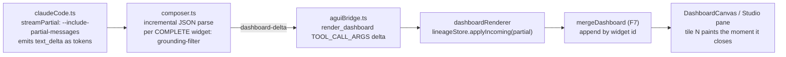

# Design Spec — Dashboard Studio + Genuine Token-Streaming

*rnd-trust-graph · R&D/PV Trust Graph · 2026-07-13*
*Status: **approved to plan** (user green-lit "Studio + streaming, both built"). Supersedes no prior spec; extends `docs/teaching/Dynamic_AI_Driven_Dashboards_Design.md` and its gap-analysis companion `docs/teaching/Dashboards_Gap_Analysis_and_SOTA_Plan.md`.*

Tags: **[FACT]** verified in repo (file cited) · **[SOTA]** external, dated + confidence · **[PROPOSAL]** recommended, not yet built.

---

## 1. Problem & goals

Today the generative dashboards (features F1–F10, all shipped **[FACT]**) render only as a **silent side-effect inside the Conversation beat's chat transcript**, and the saved-boards manager is buried in the ⚙ Tools overflow menu. Verified live 2026-07-13: the launcher, 3 starters, saved-boards panel (both sections), and a live end-to-end compose (certified badges + Save, no error) all work — but dashboards are **not a first-class destination**.

**This spec delivers three things, in one cycle:**

1. **Dashboard Studio** — a new first-class beat: a split view (grounded chat left, a persistent live interactive canvas right) where every query paints charts / flows / subgraphs / metrics, with cross-filter, drill-down, certified badges, save, and streaming reveal.
2. **Genuine token-streaming** — tiles paint *as the model composes them*, not after one buffered delta. Corrects the shipped F4, which is only a cosmetic CSS stagger **[FACT]**.
3. **Complete "stream error" / "unsupported" fix** — make the transient SSE stall a *resumable* state and the honest `NOT_IN_GRAPH` refusal a *branded refusal card*, so neither surfaces as a scary error.

Plus two verification-surfaced bugfixes (B1 duplicate React keys, B2 mid-run full reload) folded in.

**Non-goals (named, not dropped):** Mosaic/DuckDB-WASM cross-filter at >100k rows; cosmos.gl v3 GPU big-graph tile; a full A2UI v1.0 wire adapter; fast-tier local model routing. Each is a later phase in the SOTA plan.

---

## 2. Architecture

### 2.1 The Studio surface [PROPOSAL]

A new `Beat` value `"studio"` — extend the union (`web/src/App.tsx:42`), `BEAT_LABELS` (`:101`), the beat-order/nav loop (`:505`), and add a render branch (`:550`+). New tab label: **"✨ Dashboard Studio"**.

New component `web/src/dashboards/DashboardStudio.tsx` — a two-pane flex:

```
┌───────────────────────────┬─────────────────────────────────────────┐
│ CHAT (~38%)               │ LIVE CANVAS (~62%)                        │
│ • reuses the grounded ask │ • persistent DashboardCanvas              │
│   pipeline (CopilotChat)  │ • charts / hero-flow / subgraph / metrics │
│ • DASHBOARD_STARTERS chips│ • cross-filter brush (F5)                 │
│ • answer + citations      │ • ⤷ Explain drill-down → back into chat   │
│ • "→ opened in canvas"    │ • certified badges + audit line (F8)      │
│   chip instead of inline  │ • 💾 Save · 🗂 open saved (F10)            │
│                           │ • tiles PAINT AS THE MODEL TYPES (§2.2)   │
└───────────────────────────┴─────────────────────────────────────────┘
```

- **Left = the shipped grounded chat, reused.** Parameterize `CopilotChatBeat` with `dashboardTarget: "inline" | "pane"` (default `"inline"` — Conversation beat unchanged). In `"pane"` mode its `dashboardRenderer` pushes into the lineage store and drops a compact "→ opened in canvas" chip inline instead of a full board. **Same `ask()` pipeline, same grounded gate, no new answer path.**
- **Right = a persistent `DashboardCanvas`** bound to the Studio's lineage, re-painting as boards arrive/patch/stream.
- **Empty state** = the curated `DASHBOARD_STARTERS` prompts + a one-line "Ask to compose your first board."

**Reuse, not rebuild.** Every widget, brush, Explain, badge, and Save is shipped; the Studio is a new *container/route*. This keeps risk low and makes F1–F10 earn their keep in a purpose-built surface.

### 2.2 Genuine token-streaming [PROPOSAL] — corrected from the design doc

**The correction that makes this buildable on the demo path.** The composer (`bff/src/dashboards/composer.ts:104`) is a **plain-text completion, not a tool call**. The CLI wrapper (`bff/src/llm/claudeCode.ts:221`) deliberately emits the whole completion as **one `token` event** from the terminal `result` message (to avoid `stream-json`'s double-emit of the final message). So today the tokens are *not* streamed to the composer — they arrive once, at the end **[FACT]**.

**[SOTA, confidence high, 2026-07-13]** True token-streaming of the composer's *free-text* JSON **is reachable on the local Claude Code subscription path** via `--include-partial-messages` (surfaces `content_block_delta` / `text_delta`). What is **not** reachable on the CLI is *schema-constrained* partial streaming (`--json-schema` gives a guaranteed shape but only as one non-streaming blob; Anthropic closed the streaming-structured request as *not planned*, 2025-12-27). Schema-guaranteed streaming (`eager_input_streaming` + `output_config.format`, beta header `fine-grained-tool-streaming-2025-05-14`) is a **raw Messages API** feature → `LLM_PROVIDER=api` only.

**Design — incremental parse-and-heal over the existing merge engine:**



1. **`claudeCode.ts`** — add opt-in `streamPartial?: boolean`. When set: add `--include-partial-messages`; emit each `text_delta` as a `token` event; consume the terminal `result` **only** for FinOps (not as prose) so nothing doubles. Surgical, composer-only; the narration path is untouched.
2. **`composer.ts`** — run an incremental JSON parser over the growing buffer. Each time a *complete, valid* widget object closes in `widgets[]`, push it through the **same** per-widget grounding filter (`nodeIds ⊆ cited`, drop bad kind/metric) and emit `{type:"dashboard-delta", spec:{…, widgets:[thatWidget], source:"llm"}}`. The **grounding root stays composer-owned and is re-injected on every partial** — the model cannot widen grounding mid-stream. A half-typed widget is never emitted (draw-nothing preserved). On stream end, emit one final full-spec reconciliation (idempotent via `lineageStore` signature).
3. **`aguiBridge.ts`** — each `dashboard-delta` → a `render_dashboard` `TOOL_CALL_ARGS` delta. The channel already sends multiple deltas — no new protocol. Per-widget certification (`verified.ts` is already per-widget) computes as each tile lands, so a ✓ can appear the instant a tile paints.
4. **`dashboardRenderer` + `lineageStore`** — each partial → `applyIncoming(partial)`; **F7's `mergeDashboard` already appends by widget id**, so *streaming is just repeated merge*. The Studio pane subscribes (see §2.4) and re-paints per tile.

**The one real trade-off:** on the CLI path it is **stream XOR schema-guarantee**. Decision: **stream on the CLI** (free-text; our existing `parse → filter → validate → template` chain already tolerates malformed output), and treat **structured-output-guaranteed streaming as the `LLM_PROVIDER=api` upgrade** — wired as a provider branch, degrade to buffered-parse-once when `streamPartial` is off or parse trips, then to the template. This makes the headline feature show in the *local* demo the user runs.

### 2.3 "stream error" / "unsupported" fix [PROPOSAL]

Two different things wearing scary labels:

- **"stream error"** = the SSE dropping when the idle watchdog races a slow local CLI. The watchdog (`claudeCode.ts:160-170`) already `bump()`s on every stdout chunk, so a steadily-streaming answer is *not* killed — but a genuinely idle >`idleMs` gap still finishes the run. Fix on **both ends**: (a) confirm `idleMs` for the ask surface is generous; (b) frontend treats a mid-stream drop as **resumable** — "Still composing… the local model is slow — **Retry**" (one click re-submits the same question), never a red error. Distinguish transport drop from a real failure in copy.
- **"unsupported"** = the honest `NOT_IN_GRAPH` refusal mislabeled. Fix: render a branded **honest-refusal card** — "I answer only from the grounded graph; that isn't in it yet" — with 2–3 suggested in-graph questions so there is always a next action. It is a feature; show it as one.

### 2.4 Store change — per-surface lineage + subscribe [PROPOSAL] (addresses G2)

`lineageStore.ts` is a module singleton **[FACT]** (`web/src/dashboards/lineageStore.ts:23`). Two changes:
1. **`subscribe(listener)` + notify** in `applyIncoming`/`resetLineage` so the Studio right-pane re-renders reactively (currently pull-only).
2. **Per-surface lineage keying** so the Studio and the Conversation beat don't bleed boards into each other: key `current`/`lastIncomingSig`/`lastResult` by a `surface` id (`"studio" | "conversation"`), or instantiate a store per surface. Reset on thread change stays.

---

## 3. Trust invariants — preserved (non-negotiable, from `CLAUDE.md`)

Every change below holds the line:
- **Spec stays structurally inert** — no new field can carry a value/URL/HTML/Mermaid; streaming emits the *same* widget shape, just earlier.
- **Grounding root is composer-owned and re-filtered on every partial** — a streamed partial can never reference an un-cited node.
- **Compose/agent path stays read-only** — no graph writes; all writes remain via `hitl/ops.ts`.
- **HITL/approval widgets stay host-chrome** — never spec-expressible, even mid-stream.
- **FAIR canvas byte-identical** — `graph/queries.ts` `WHERE NOT n:Safety` untouched.
- **New store event is additive** — no new overlay `ChangeOp` (so no `store.ts rebuildOverlay` replay needed).

---

## 4. Design critique / red-team — "what we've missed"

Numbered so the plan can close each.

- **C1 — Dual surfaces (G1).** Studio pane *and* Conversation-beat inline is two places a board can appear. *Answer:* the `dashboardTarget` prop makes it explicit per surface; Conversation stays inline, Studio routes to pane. The Conversation inline render is **not** deprecated (it's a proven demo beat). Documented so it's a choice, not an accident.
- **C2 — Cross-surface bleed (G2).** The singleton lineage. *Answer:* §2.4 per-surface keying. Test: a board composed in Studio must not appear in the Conversation beat's inline render and vice-versa.
- **C3 — Stream XOR schema on CLI (G4).** Free-text streaming has no shape guarantee. *Answer:* accepted; the existing validate/template chain is the net, and the API path is strictly better when a key is present. Called out in the demo script so it's honest.
- **C4 — Catalog drift (G3).** Kind-list triplicated (shared types, composer `KNOWN_KINDS`, Zod enum). *Answer:* out of scope for this cycle; the A2UI catalog handshake is the structural fix, tracked in the SOTA plan. Interim guard: a unit test asserts the three lists are identical.
- **C5 — Working-board loss on reload (G5, B2).** A tab reload drops an unsaved streaming board. *Answer:* persist the Studio lineage to `sessionStorage` on each merge and rehydrate on mount; Save (F10) remains the durable path. Confirm B2's reload is dev-only Vite HMR.
- **C6 — Duplicate React keys (B1).** `ead6eaad-…-custom-before/-after` repeating inside `ErrorBoundary`. *Answer:* trace the non-unique key in the CopilotKit custom-message render array; make keys unique (suffix by role+index). Real bug, fixed this cycle.
- **C7 — Streaming a11y.** Tiles appearing + pulsing mid-stream can be jarring / violate reduced-motion. *Answer:* gate reveal/pulse on the existing `useMotion()`; wrap the canvas in `aria-live="polite"` and announce "N tiles composed" rather than per-tile chatter.
- **C8 — Latency still real.** Even streaming, the first tile waits on the model's first complete widget (~seconds on local CLI). *Answer:* streaming converts dead time into *visible progress*; the template still paints instantly when live mode is off. The API path is the latency lever.
- **C9 — Certification is pattern-match, not data-correctness (unchanged C3 from design doc).** Re-flagged: a ✓ means "kind over cited nodes of the required kinds matches a curated query," not "the data is right" — that's the faithfulness score's job. Tooltip says so.

---

## 5. Test plan (targeted BFF subsets — full `npm test` hangs)

- **Streaming grounding (pure, LLM-free):** feed a partial JSON buffer with a half-typed widget → assert *no* widget emitted; feed a complete widget referencing an un-cited id → assert it's filtered out of the partial; assert grounding root present on every `dashboard-delta`.
- **Parse-and-heal:** progressive buffers → assert monotonic widget count, final reconciliation equals the buffered-parse-once result (idempotent).
- **`claudeCode.ts` streamPartial:** mock stdout `text_delta` events → assert tokens emitted incrementally and terminal `result` not double-emitted as prose; FinOps still recorded once.
- **Store per-surface:** apply a board under `"studio"` → assert `"conversation"` lineage unchanged; `subscribe` fires on merge.
- **Refusal card:** `NOT_IN_GRAPH` answer → assert refusal-card path, not error, with ≥1 suggestion.
- **Catalog-drift guard:** assert shared kinds === composer `KNOWN_KINDS` === Zod enum.
- **Frontend:** Studio renders both panes; a composed board routes to the pane (not inline) under `dashboardTarget:"pane"`; live render-proof on `:5173` (compose → tiles paint progressively → certified badge → Save), `estimated:false` confirms live.
- **B1:** no duplicate-key console warning after a chat turn.

Standard gate: `npm run typecheck` (3 ws) → targeted BFF tests → live render-proof.

---

## 6. Honest scope

**This cycle builds:** the Studio beat + split view; genuine free-text token-streaming on the CLI path with parse-and-heal-over-merge (+ API structured-output branch); the stream-error/unsupported UX fix; per-surface lineage + subscribe; and bugfixes B1/B2/C5. **Deferred (SOTA plan):** A2UI catalog handshake, cosmos.gl v3, Mosaic/DuckDB, fast-tier routing. **Known residual:** CLI streaming has no schema guarantee; certification is pattern-level. Both documented for the demo script.
