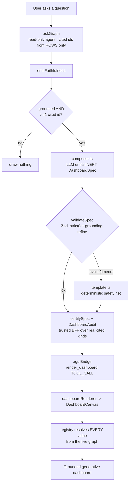
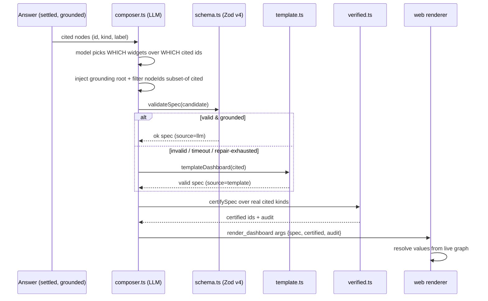
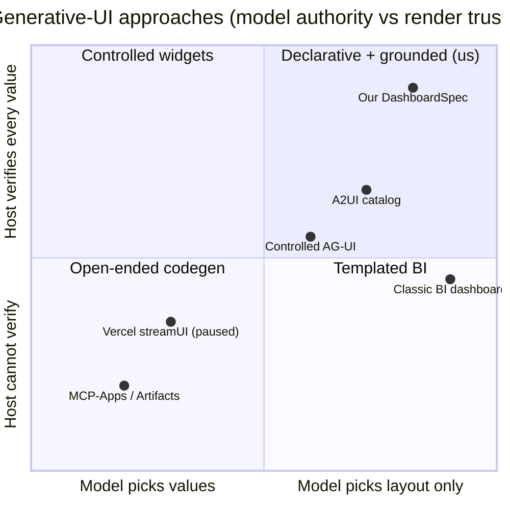

# Dynamic, AI-Driven Dashboards — Technical Design

**Query-driven generative dashboards over a grounded knowledge graph**

*pharmaceutical R&D · R&D / Pharmacovigilance Trust Graph · technical design*
*Date: 2026-07-12*

> **How to read this document.** Every claim is tagged. **[FACT]** = already built and verified in this repository (file paths cited). **[PROPOSAL]** = a recommended change we have *not* yet built. **[SOTA]** = an external state-of-the-art development, date-stamped, with a confidence flag. We are deliberately honest about what is shipped versus aspirational: Feature 4 is only *cosmetically* progressive today, and Phase 3 is unbuilt. Both are called out plainly.

---

## 1. Executive summary

Static dashboards answer questions that someone anticipated at build time. The analyst's *actual* question — "why was myocarditis flagged for this checkpoint inhibitor, and what is the evidence?" — rarely maps onto a pre-built tile grid. The gap is filled with screenshots, spreadsheets, and Slack threads.

**The thesis of this design: the dashboard should be composed *per answer*, by the model, from the same grounded evidence the chat answer already stands on — and it should be trustworthy by construction, not by review.**

Concretely, when the app produces a grounded answer over the knowledge graph, a large language model composes a **`DashboardSpec`** — a small, declarative description of *which* widgets to show over *which* already-cited nodes. The model never emits a number, a URL, a chart, an HTML string, or Mermaid source. A trusted back-end validates that spec, certifies the tiles whose queries match a curated catalogue, and the front-end resolves every displayed value from the live graph. The result is a dashboard that is **grounded-by-construction**: it can only ever show data the answer actually cited.

**What is already live in this repository [FACT].** The `@rnd/dashboards` feature package is built and verified through Phases 1 and 2 — features 1 through 8 of a 10-feature plan. It has been proven end-to-end against the real stack (Neo4j + a live local Claude Code model call, `estimated:false` in the FinOps ledger), producing a `render_dashboard` tool call with certified tiles and an audit record. This document describes that build accurately, then folds in the June–July 2026 state of the art and ranks the upgrades worth making next.

---

## 2. Requirements

### 2.1 Functional

| # | Requirement | Status |
|---|-------------|--------|
| F-a | From a grounded chat answer, compose and render a dashboard with no extra user action. | **Built [FACT]** |
| F-b | The model chooses widget selection and layout; it never supplies data values. | **Built [FACT]** |
| F-c | A deterministic fallback must always produce a valid, grounded board (never render nothing, never render ungrounded). | **Built [FACT]** |
| F-d | Widgets reuse the app's existing grounded primitives (charts, ledgers, subgraph, mechanism flow). | **Built [FACT]** |
| F-e | Cross-filter / linked brushing across tiles. | **Built [FACT]** (shared-state engine) |
| F-f | Per-tile drill-down that asks a grounded follow-up. | **Built [FACT]** |
| F-g | Follow-up turns patch the board in place (append-only). | **Built [FACT]** |
| F-h | Certified-tile trust badges + an auditable provenance record. | **Built [FACT]** |
| F-i | Truly progressive/streaming tile paint. | **Partial [FACT]** — CSS staggered reveal only; not token-streamed (see §5, Feature 4). |
| F-j | Save / publish / share a dashboard, and scheduled snapshot briefs. | **Not built [FACT]** — Phase 3. |

### 2.2 Non-functional

- **Latency.** The composer is a *second* model call after the answer. The local CLI path is slow (10–25 s); the cloud API path (`LLM_PROVIDER=api`) is the documented latency lever. The front-end masks the wait with progressive reveal.
- **Determinism of the fallback.** Same inputs → byte-identical template spec (asserted in tests) so the fallback is reproducible for audit.
- **Testability.** Grounding guarantees are exercised by pure, LLM-free unit tests (`composeFromModelText`, `validateSpec`, `certifySpec`, `mergeDashboard`). 31/31 dashboards tests pass; typecheck clean across all three workspaces.
- **Regulatory fit.** The trust-split (read-only compose path, host-chrome-only approvals, PROV-O ledger) aligns with 21 CFR Part 11-style auditability — a confirmed whitespace for AI analytics in regulated life sciences.

### 2.3 Trust / grounding invariants (non-negotiable)

These are enforced *structurally*, not by prompt, and are the reason a generative dashboard is safe to put in front of a regulated user:

1. **The spec is structurally inert.** A widget can name only a `kind`, a free-text `title` (escaped), a subset of already-cited node ids, and — for a metric tile — one of a **fixed enum** of server-computed metrics (`faithfulness | cited-count | coverage`). There is **no field** in which a number, URL, HTML, or Mermaid source can be expressed. Enforced by Zod `.strict()` in `bff/src/dashboards/schema.ts`.
2. **The composer owns the grounding root.** `citedNodeIds` is set by trusted code to the answer's *real* citations; every `widget.nodeIds` is filtered to that set (`bff/src/dashboards/composer.ts`). The model literally cannot reference a node the answer did not cite; a super-refine in the schema rejects any that slip through.
3. **The renderer owns every value.** The front-end resolves cited ids against the live graph payload, dropping unknown ids — never fabricating (`web/src/dashboards/DashboardCanvas.tsx`, `resolveCited`).
4. **Certification is computed by trusted code, never declared by the spec.** The inert spec cannot carry a `certified` flag; certification rides *alongside* the spec (`bff/src/dashboards/verified.ts`).
5. **HITL / approval widgets are not spec-expressible.** Approval dialogs are host-chrome only, so a composed spec can never forge an "Approve" control (UI-impersonation guard).
6. **The compose path is read-only.** All graph writes go through the authorized HITL writer; the agent/composer path never mutates.

---

## 3. Architecture

The pipeline reflects the real code seams. The dashboard is emitted only on a grounded, cited answer — the same gate as the existing `render_evidence` block.

**The compose → validate → certify handshake** — where the trust boundary actually sits:

**Real files that implement this:**

| Layer | File | Role |
|-------|------|------|
| Contract | `shared/src/dashboard.ts` | Plain-TS `DashboardSpec`, `DashboardWidget`, `DashboardAudit`, `mergeDashboard` (no Zod in shared). |
| Validator | `bff/src/dashboards/schema.ts` | Zod v4 `dashboardSpecSchema`, `.strict()` + grounding super-refine, `validateSpec`. |
| Composer | `bff/src/dashboards/composer.ts` | LLM-primary compose; `composeFromModelText` (pure, testable); grounding-root injection. |
| Fallback | `bff/src/dashboards/template.ts` | Deterministic `templateDashboard` safety net. |
| Certification | `bff/src/dashboards/verified.ts` | Curated `VERIFIED_QUERIES`; `certifyWidget` / `certifySpec`. |
| Renderer | `web/src/dashboards/dashboardRenderer.tsx` | `render_dashboard` tool-call renderer (imports `@copilotkit/react-core/v2`). |
| Canvas | `web/src/dashboards/DashboardCanvas.tsx` | Grid layout, reveal/pulse, brush bar, Explain, certified badges, audit line. |
| Registry | `web/src/dashboards/registry.tsx` | Maps widget kinds 1:1 to grounded primitives; cross-filter subset. |
| Lineage | `web/src/dashboards/lineageStore.ts` | Single-lineage merge store (`applyIncoming`), idempotency + continuity. |

> **A note on transport.** The dashboard rides the same **AG-UI** `render_dashboard` tool-call channel the app already uses for `render_evidence`. There is no new protocol — this is a deliberate reuse of the existing streaming seam.

---

## 4. The declarative-generative-UI landscape

Using CopilotKit's 2026 taxonomy, generative UI splits three ways by *how much authority the model has over what renders*:

- **Controlled generative UI** — the app hands the model a fixed set of named components; the model fills in props. Safe, but rigid.
- **Declarative generative UI** — the model emits a declarative *spec* the host validates and renders through a trusted registry. Flexible and safe *if the spec is inert.* **This is where our design sits.**
- **Open-ended generative UI** — the model emits executable code or full apps (MCP-Apps, Artifacts, `streamUI`). Maximally flexible, but the host cannot guarantee what a rendered value means. **Excluded from the grounded path.**

Our position on two axes — *how much the model decides* vs *how much the host can verify*:

The distinctive corner is top-right: the model picks *layout only* (not values) **and** the host verifies *every* value against the live graph. Classic BI verifies values but has no model authoring; open-ended codegen has model authoring but no host verification. Our spec deliberately keeps both.

> **Adversarial reality check [SOTA, confidence: high].** **Vercel AI SDK RSC `streamUI` is paused** — the maintainers steered momentum toward declarative specs rather than streamed server components. Do **not** build the grounded path on `streamUI`. Much of the top search content on "generative dashboards" is vendor blogspam; this document prefers primary sources (InfoQ, OpenJS, Anthropic docs, the A2UI and CopilotKit repos).

---

## 5. What's built today — Features 1–8 (honest status)

**Phase 1 — vertical slice (grounded, streaming end-to-end).** [FACT]

1. **`DashboardSpec` + widget registry + `render_dashboard` tool call.** Flat widget list; seven widget kinds map 1:1 to existing grounded primitives (`citation-chips`, `coverage-header`, `evidence-ledger`, `evidence-subgraph`, `stat-chart`, `hero-flow`, `metric`). Emitted right after the `render_evidence` block, same grounded gate.
2. **LLM composer (primary path).** `composer.ts` runs a one-shot completion after `emitFaithfulness`, on the grounded branch only. The prompt hands the model the cited nodes and demands JSON with fixed widget kinds; the composer then *re-injects* the grounding root and filters `nodeIds` regardless of what came back.
3. **Deterministic template safety net.** `templateDashboard` builds a valid grounded spec from cited nodes alone — used on invalid/timeout/repair-exhausted/live-off. Guarantees a valid grounded board always exists.
4. **Streaming progressive render — PARTIAL. [FACT, honest]** Today the composer emits the whole spec in one delta; the front-end reveals tiles with a **staggered CSS entry animation** (`rnd-dash-in`, 60 ms stagger, gated by the in-app `useMotion()` toggle). This *masks* latency but is **not** true token-level streaming — the tiles do not paint as the model types them. This is the single biggest gap between the build and the design intent, and §7 recommends the fix.

**Phase 2 — interaction & trust.** [FACT]

5. **Cross-filter / linked brushing.** `DashboardCanvas` holds a `focusIds` brush; clicking a citation chip narrows every other widget via `registry.subset()`; a filter bar shows the brush with a Clear. Draw-nothing discipline when a widget has no overlap. *Engine = shared-state over the existing primitives (not Mosaic/DuckDB — see §7).*
6. **Tile drill-down.** Each widget has an "⤷ Explain" action that submits a grounded follow-up (`onAsk(explainQuestion(widget))`), answered from the live graph — no new answer path. Bridged via `askRef` from CopilotSurface.
7. **Live agent-patched dashboards.** A follow-up turn composes a new board that is **merged** into the prior one by widget id (`mergeDashboard` in `@rnd/shared`): append-only by default, update-in-place on a recurring id, union `citedNodeIds`. `lineageStore.ts` keeps one lineage with a content-signature idempotency guard and a continuity check (unrelated boards start fresh). Changed tiles pulse once.
8. **Certified badges + `DashboardAudit`.** `verified.ts` holds a small curated `VERIFIED_QUERIES` catalogue (e.g. disproportionality over a `SignalStat`, mechanism chain over `AdverseEvent` + `Drug`). Certification is computed by trusted BFF code over the *real* cited-node kinds and rides alongside the inert spec as `certified: string[]` plus a `DashboardAudit` (model, `estimated:false` live proof, faithfulness score/band, matched query ids). The canvas shows a ✓ badge per certified tile and an audit summary line.

**Verification state [FACT].** Typecheck clean (3 workspaces); 31/31 dashboards tests (18 Phase 1 + 7 verified + 6 merge); **live BFF end-to-end** — a real Claude-Code compose emitted `certified:['w2','w3','w4','w5']` and audit `{model: claude-opus-4-8, estimated:false, faithfulnessScore:0.85, certifiedCount:4}`; front-end render-proofed via a fiber-injected copy of the exact live payload.

**Not built [FACT].** Phase 3 — Feature 9 (scheduled snapshots + delta briefs) and Feature 10 (publish / save / share + governance wrap). See §9.

---

## 6. What's new — June–July 2026 SOTA refresh

External developments since the original design, each dated and confidence-flagged. This is the "what we're adopting" watch-list; §7 turns it into ranked upgrades.

| Development | Date / source | What it is | Relevance to us | Confidence |
|-----------|---------------|------------|-----------------|-----------|
| **A2UI v0.9** (v0.9.1 production; v1.0 = release candidate) | 3 Jul 2026, InfoQ | Framework-agnostic declarative genUI standard. New **flat `{component, ...props}`** JSON, a **3-step catalog handshake** (client advertises the tile catalogue it can render; the agent only emits renderable tiles), and **JSON-Pointer bidirectional data binding**. | Our `DashboardSpec` already converged on a flat widget list; A2UI validates the shape and adds the catalog handshake + pointer binding we should align to. | **High** |
| **Claude structured outputs → GA** | 2026, Anthropic docs | Schema-guaranteed JSON across current models (incl. Opus 4.8 / Haiku 4.5). No recursive schemas. | Constrain the composer call with the `DashboardSpec` JSON-schema → kills the malformed-spec failure class. Our flat list survives the no-recursion caveat. | **High** |
| **Fine-grained tool streaming → GA** | 2026, Anthropic docs | Tool-call arguments stream token-by-token. | Directly closes the Feature-4 gap: tiles can paint progressively as the spec streams, not after one full delta. | **High** |
| **A2UI Agent SDK "incremental-parse-and-heal" streaming** | 2026, A2UI SDK | The pattern for safely rendering a half-generated spec (parse partial JSON, render what is complete, heal on the next chunk). | The rendering counterpart to fine-grained streaming — adopt for progressive `DashboardSpec` render. | **High** |
| **cosmos.gl v3** | 25 Jun 2026, OpenJS | GPU big-graph renderer on **luma.gl / WebGL 2** (NOT WebGPU — correcting an earlier mislabel). | Use for large union-subgraph tiles; degrade to the existing SVG force-graph for small certified graphs. | **High** |
| **Mosaic / vgplot + DuckDB-WASM** | 2026 | Cross-filter engine for >100k-row data, in-browser via DuckDB-WASM. | The scale upgrade behind Feature-5 brushing when a tile's grounded data exceeds what shared-state can filter smoothly. | **Medium** |
| **"Citation grounding"** (industry term) | 2026 | The now-standard name for per-claim, auditable provenance in genUI/RAG. | Positions our certified badges + `DashboardAudit` + PROV-O trust-split as *table-stakes validation*, not a nice-to-have. | **Medium** |
| **Vercel `streamUI` paused** | 2026 | RSC-streamed UI generation halted; momentum moved to declarative specs (A2UI). | Confirms our declarative-spec bet; a warning not to build on `streamUI`. | **High** |

---

## 7. Recommended upgrades, ranked

Top five, each with an integration note and its risk. All are **[PROPOSAL]** unless noted.

### 1. Align the spec shape to A2UI + advertise the tile catalogue
**Why.** A2UI's flat `{component, ...props}` shape and catalog handshake are now the emerging standard; aligning reduces future adapter cost and lets us interoperate with A2UI-aware clients. Our registry (`web/src/dashboards/registry.tsx`) *is* the catalogue — expose it as an advertised list so the composer is told, per session, exactly which tile kinds are renderable.
**Integration.** Rename/adapt `DashboardWidget` fields toward `{component, props}`; emit the registry's kind list into the composer prompt (and, later, into an A2UI catalog message). Keep the inert-value contract intact.
**Risk.** Low–medium. A2UI is still a *release candidate* — align the shape but do not hard-couple to a pre-1.0 wire format; keep our Zod schema as the source of truth.

### 2. Constrain the composer with structured outputs + enable fine-grained streaming
**Why.** These two GA features together kill the malformed-spec class *and* fix Feature 4. Structured outputs guarantee schema-valid JSON (demoting our repair loop to a rare fallback); fine-grained streaming lets tiles paint as arguments arrive.
**Integration.** Pass the `DashboardSpec` JSON-schema as the composer's `output_config.format`; switch the composer call to the streaming tool path; the front-end consumes deltas via parse-and-heal (upgrade #3).
**Risk.** Low. Caveat: no recursive schemas — our flat widget list is fine, but never nest a layout tree. The grounding-root injection in `composer.ts` must stay even with guaranteed JSON (structured outputs guarantees *shape*, not *grounding*).

### 3. Incremental parse-and-heal rendering + JSON-Pointer binding
**Why.** The rendering half of true streaming, and the mechanism for A2UI-style bidirectional data binding (a tile can bind to a pointer into the data model and update in place).
**Integration.** Replace the single-delta render in `dashboardRenderer.tsx` with a partial-JSON parser that renders complete widgets and heals on the next chunk; introduce JSON-Pointer refs for tile→data binding, resolved (as today) against the live graph.
**Risk.** Medium. Partial renders must never show an *ungrounded* intermediate — resolve every id against the graph before paint, and keep the draw-nothing discipline for un-resolvable ids.

### 4. cosmos.gl v3 big-graph tile
**Why.** The `evidence-subgraph` tile degrades on large unions; a GPU renderer keeps big grounded subgraphs interactive.
**Integration.** Add a `evidence-subgraph-large` render path in the registry that switches to cosmos.gl (WebGL 2 / luma.gl) above a node-count threshold; keep the existing SVG force-graph for small certified graphs (certification and legibility both favour SVG at small N).
**Risk.** Low–medium. Bundle size and WebGL context management; correct the label internally — this is **WebGL 2, not WebGPU** (deck.gl's WebGPU path is still not production-ready).

### 5. Mosaic / vgplot + DuckDB-WASM cross-filter at scale
**Why.** Feature 5's shared-state brush is fine at demo scale but will not cross-filter >100k grounded rows smoothly.
**Integration.** Behind the existing brush API, swap the filter engine to Mosaic Selections over a DuckDB-WASM table materialised from the grounded rows; keep the current shared-state engine as the small-data default.
**Risk.** Medium. DuckDB-WASM adds weight and a data-loading step; only worth it when a tile's grounded row count justifies it. Grounding is preserved because the DuckDB table is materialised *from* cited rows, never fetched independently.

> **Explicitly deferred (named, not dropped):** fast-tier local model routing (cloud API remains the latency lever); a full A2UI v1.0-RC wire adapter (we adopt A2UI *shape*, not its transport, until 1.0 ships); Open-JSON-UI as a third spec dialect on the same transport.

---

## 8. Design critique / red-team

Where dynamic dashboards break — and how this architecture answers each. Honest self-review.

**C1 — Latency of a second local compose call.** A 10–25 s local CLI compose after every answer is unacceptable UX.
*Answer:* the composer is gated on live mode and hard-capped at 30 s (`COMPOSE_TIMEOUT_MS`); on timeout it drops to the deterministic template instantly. The documented `LLM_PROVIDER=api` path is the real latency lever, and progressive reveal masks the wait. Upgrade #2 (streaming) makes the wait *visible progress* rather than dead time.

**C2 — Spec injection.** Could a crafted answer or node label smuggle a value, link, or markup into a tile?
*Answer:* structurally impossible. The spec is `.strict()` inert — there is no field for a value, URL, HTML, or Mermaid source. Titles are rendered as escaped text. The renderer builds any Mermaid itself under `securityLevel:"strict"`; it never accepts model- or graph-supplied diagram strings. Adversarial node labels are a named test fixture.

**C3 — Over-trust of a "certified" badge.** A green ✓ could lull a reviewer into treating a tile as validated when only its *pattern* matched.
*Answer:* certification is scoped precisely — it means "this tile's kind, over cited nodes of the required kinds, matches a hand-curated verified query" (`verified.ts`), and the tooltip says exactly that. It is computed by trusted code, never declared by the spec, so it cannot be forged. It does *not* claim the underlying data is correct — that is the faithfulness score's job, shown separately in the audit line. **Residual risk:** the badge's meaning must be trained/documented for reviewers; a badge is not a substitute for the ledger.

**C4 — Empty-dashboard UX.** A refusal or a cited-but-thin answer could produce a bleak or a sad empty grid.
*Answer:* the emit gate requires grounded + ≥1 cited id, so a refusal draws nothing at all. When cited-but-sparse, the template guarantees a valid, sensibly-ordered board rather than an empty one. `DashboardCanvas` also returns `null` if zero cited nodes resolve against the live graph.

**C5 — Cost of composing on every answer.** A model call per answer has token cost and rate-limit exposure.
*Answer:* the compose is a single one-shot completion (no tools — the answer already did the graph work), skipped entirely when live mode is off. The FinOps ledger records each call (`finopsSurface: "dashboard"`) so cost is observable. Structured outputs (upgrade #2) also shortens the call by removing repair round-trips. **Open lever:** a fast-tier (Haiku-class) composer would cut cost further — deferred, not wired.

**C6 — Catalog drift.** If the front-end registry and the composer's known-kind list diverge, the model can emit a tile the client cannot render (or vice-versa).
*Answer:* today the kind list is duplicated in three places (shared types, `composer.ts` `KNOWN_KINDS`, the Zod enum) and kept in sync by tests + typecheck. The A2UI catalog handshake (upgrade #1) is the *structural* fix: the client advertises its catalogue and the composer is told what it may emit, eliminating drift by construction.

**C7 — Stale accumulation in the lineage.** Feature 7's merge could grow a board with stale tiles across unrelated questions.
*Answer:* `lineageStore.continues()` starts a fresh lineage when a new board shares neither a widget id nor a cited node with the prior one; the board only grows while the user drills into the same subject. Idempotency guards against re-merging the same spec into itself on re-render.

**C8 — Trusting a pre-1.0 external standard.** Betting on A2UI (RC) or a GA-but-new streaming API could age badly.
*Answer:* we adopt A2UI *shape*, not its wire format, and keep our own Zod schema as the source of truth; the transport stays the app's existing AG-UI channel. Structured outputs and fine-grained streaming are GA, not preview. Every external dependency in §7 has a documented degrade path to what is built today.

---

## 9. Honest scope & roadmap

**Shipped and verified [FACT].** Features 1–8. Grounded-by-construction compose → validate → certify → render, cross-filter, drill-down, live merge/patch, certified badges + audit. Proven live end-to-end (`estimated:false`).

**Known gap in the shipped build [FACT].** Feature 4 is *cosmetically* progressive (staggered CSS reveal), not token-streamed. Upgrades #2 and #3 in §7 are the fix.

**Not built — Phase 3 [FACT].**
- **Feature 9 — scheduled dashboard snapshots + delta briefs.** A file-backed snapshot store mirroring the existing `playbooks/routines.ts`, reusing `playbooks/cron.ts` verbatim; a headless `composeSnapshot` executor that delta-detects vs the prior snapshot and emits a brief linking back into chat. *Design exists; not implemented.*
- **Feature 10 — publish / save / share + governance wrap.** Turn a chat-composed board into a saved, refreshable spec (`/api/dashboards` CRUD mirroring the thread-store pattern); a "Send → Review" wrap reusing the HITL apply/revert so a published dashboard carries a reversible, reviewer-stamped audit trail. HITL widgets stay host-chrome. *Design exists; not implemented.*

**Recommended sequence.** (1) structured outputs + fine-grained streaming + parse-and-heal — closes the one real gap in the shipped build; (2) A2UI shape + catalog handshake — removes catalog drift and future-proofs the contract; (3) Phase 3 publish/snapshots — turns a per-answer artifact into a durable, shareable, governed asset; (4) cosmos.gl and Mosaic — scale levers, pulled in only when grounded data size demands them.

---

*Provenance of claims: repository code (cited inline) for all [FACT] items; InfoQ (A2UI, 3 Jul 2026), OpenJS (cosmos.gl v3, 25 Jun 2026), and Anthropic documentation (structured outputs / fine-grained streaming GA) for [SOTA] items. Confidence flags are the author's, per source strength. This is a design deliverable, not a commitment of dates.*
