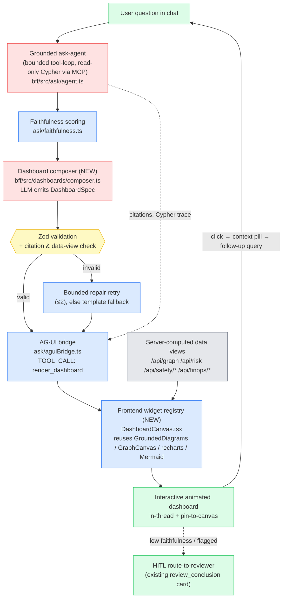
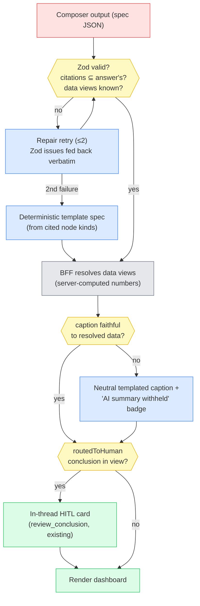
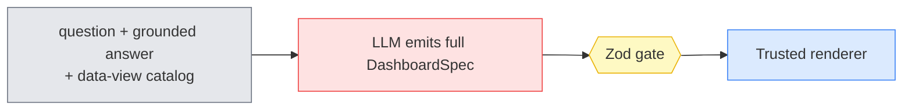
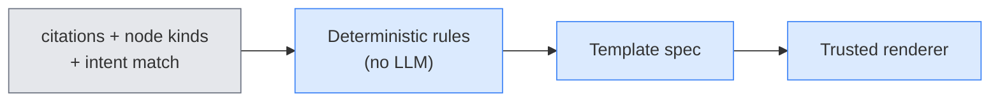
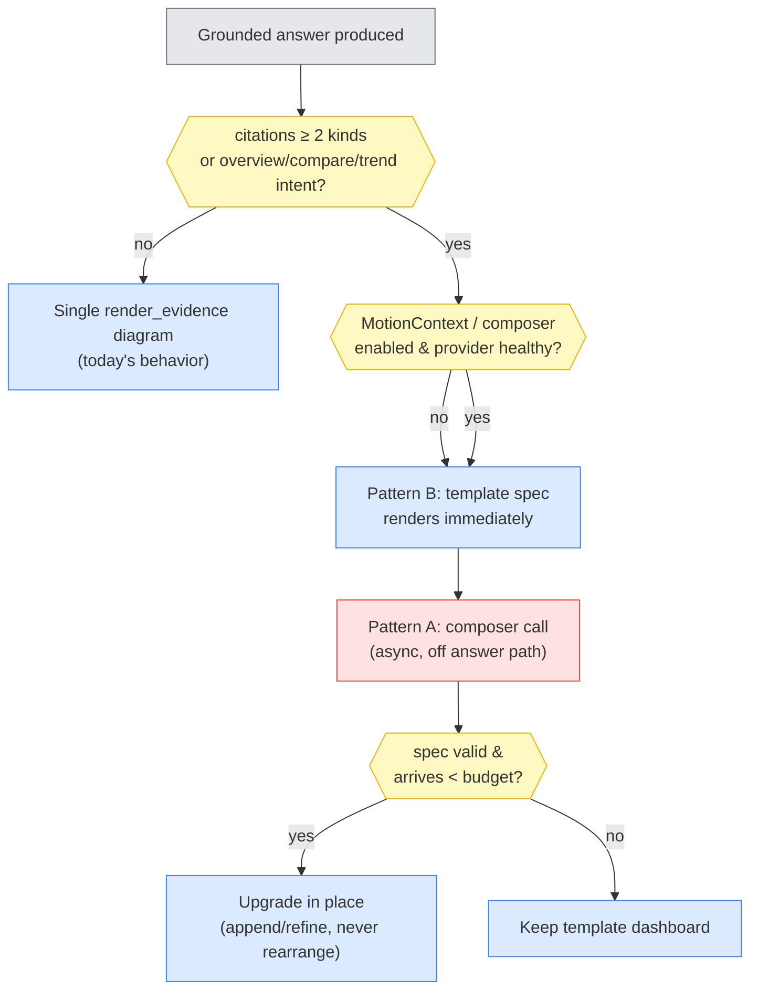

# Generative Dashboards — Technical Design & Architecture

**Query-driven, animated, interactive dashboards composed live from the AI chat — replacing static panels in `rnd-trust-graph`.**
Audience: pharmaceutical R&D stakeholders + the build team. Version 1.0 — 2026-07-12. Research current as of **July 2026**.

---

## 0. How to read this document

**What this is.** A research-backed design for turning the app's chat into a *dashboard composer*: the user asks a question ("show me the safety picture for Drug X across trials"), and instead of a paragraph plus a fixed panel, the system composes an interactive, animated dashboard — flow diagrams with moving particles, drill-downable charts, evidence subgraphs — grounded in the same Neo4j + reasoner data that powers today's static beats.

**The persona panel.** The design was argued through five voices; their stakes drive component decisions in §5:

| Persona | Role | Refuses to compromise on |
|---|---|---|
| **Maya** | Solution architect | Simplicity and composability — the expensive LLM step does only what deterministic code can't. |
| **Dev** | Pharma/PV domain SME | Safety analytics must be correct and complete — PRR/ROR, MedDRA terms, trial context — never flattened into generic "charts." |
| **Sam** | MLOps / evals lead | Nothing ships without a measurable quality gate; silent failures (a *wrong* dashboard that looks right) are tracked, not just crashes. |
| **Priya** | Security & grounding lead | The LLM never invents a number and never injects markup; untrusted strings are data, not instructions. |
| **Alex** | UX / motion / HITL lead | Motion must mean something (flow, causality, change) — and the generated surface must stay auditable and accessible. |

**Decided vs. proposed vs. open.**
- *Decided (observed fact):* everything in §1.3 constraints and the codebase-seam descriptions (§4–5 file references are real, verified in code).
- *Proposed:* the DashboardSpec architecture (§3–§8) — the recommendation of this document.
- *Open:* items carried forward from the critique (§10) that research could not fully close (§11 flags them).

**Reading paths.** Execs / account team: §1, §3, §13–14. Architects: everything. Build team: §4–§8 + §13.2.

---

## 1. Requirements

### 1.1 Functional

| # | Capability |
|---|---|
| F-1 | From a natural-language chat query, compose a **multi-widget dashboard** (charts, flow diagrams, subgraphs, stat tiles, ledgers) rather than a single fixed diagram. |
| F-2 | Dashboards are **interactive**: click a node/bar/stage → drill down, focus the main canvas, or feed the element back into the chat as context for a follow-up question (the existing node-pill pattern, generalized). |
| F-3 | Dashboards are **animated**: flows animate along paths (particles/dash-draw), values transition, appearance is staged ("narrated") rather than dumped — consistent with the in-app MotionContext toggle. |
| F-4 | Dashboards are **grounded-by-construction**: every number is server-computed; every rendered node id exists in the live graph; a refusal (`NOT_IN_GRAPH`) draws nothing. |
| F-5 | Dashboards **persist and replay**: a composed dashboard can be reopened from the thread (thread-store), pinned to a full-width canvas, and exported into the dossier/PROV-O story. |
| F-6 | Static panels (FinOps, Eval Scorecard, Safety Radar) remain, but the same widget registry can re-render them — one render kit, two entry points (static routes + generative chat). |
| F-7 | Faithfulness/confidence surfaces on the dashboard itself (badge per widget or per dashboard), with the existing HITL route-to-reviewer escape hatch. |

### 1.2 Non-functional

- **Latency:** first widget visible < ~3 s after the grounded answer starts streaming; full dashboard < ~10 s p95 on the local-CLI provider (the compose step must not add a second full LLM round-trip on the critical path where avoidable).
- **Determinism envelope:** identical query + identical graph state ⇒ semantically identical dashboard (same widgets, same data; layout may vary within the grid contract).
- **Fallback:** if the composer LLM call fails/times out or the spec fails validation after bounded retries, degrade to today's behavior (`render_evidence` single diagram) — never a broken or empty response.
- **Perf:** a thread with 10+ dashboards must not degrade scroll/interaction (widget virtualization / freeze-on-blur).
- **Accessibility:** every widget keyboard-reachable; motion honors the in-app toggle; charts carry text equivalents.

### 1.3 Constraints (observed, verbatim from the codebase)

- **Stack is fixed:** React 18.3 + Vite 6 + Tailwind v4; CopilotKit `2.0.0-next.1` over AG-UI `@ag-ui/core 0.0.42`; Fastify 5 BFF; Neo4j via read-only MCP (`uvx mcp-neo4j-cypher --read-only`); LLM = local `claude` CLI (subscription auth) with a cloud-API fallback and a deterministic scripted fallback.
- **The grounding invariant is non-negotiable:** answers cite only node ids returned by real read-only Cypher; the UI draws only `citedNodeIds ∩ /api/graph`. (`bff/src/ask/agent.ts`, `web/src/components/GroundedDiagrams.tsx`.)
- **The generative-UI seam already exists:** the BFF emits AG-UI `TOOL_CALL_START/ARGS/END/RESULT` events (`bff/src/ask/aguiBridge.ts`); the frontend maps tool-call names to React renderers via the `renderToolCalls` prop on `CopilotKitProvider` (`web/src/beats/CopilotChatBeat.tsx:132`), today registering `read_neo4j_cypher`, `route_strategy`, `render_evidence`, `faithfulness`, `hallucination_flag`, and the HITL `review_conclusion` card.
- **Render primitives exist:** `GroundedDiagrams.tsx` (StatChart / HeroFlow-Mermaid / EvidenceLedger / EvidenceSubgraph / CitationChips), `GraphCanvas.tsx` (react-force-graph-2d with flowing-path particles + `MotionContext`), `DossierStory.tsx` (beat-by-beat narrated post-run visuals), recharts, mermaid 11 (`securityLevel:"strict"`).
- **Motion:** in-app `MotionContext` toggle (default ON), *not* the OS reduce-motion query (a deliberate, tested decision — the OS gate silently killed flow animation on Win11 Enterprise).
- **Testing reality:** Node test runner in `bff/`; full `npm test` hangs on CLI eval tests — targeted suites only; web is typecheck + live render-proof.
- **Domain:** pharmacovigilance / R&D trust — auditability (PROV-O dossier, KMC ledger, faithfulness scores) is a product feature, not overhead.

---

## 2. The top approaches the community uses

Five distinct approach *families* dominate LLM→UI as of July 2026. They are mostly **layered, not mutually exclusive** — mature products combine them.

### 2.1 Tool-call → registered component renderers

The LLM emits a structured tool call; the frontend maps the tool name to a pre-registered, developer-authored React component that renders the typed arguments. The model never produces UI code — only data.

- **Implementations:** CopilotKit generative UI (`renderToolCalls` / `useRenderTool` / `useComponent` — components-as-tools with typed props, streaming partial args and Running→Done states); Vercel AI SDK client-side `useChat` + tool invocations (the RSC `streamUI` path from AI SDK 3.0 is **paused**; Vercel now recommends the client-side pattern); assistant-ui's tool-UI registration.
- **Wins:** the strongest trust story of any family — output is constrained to your component library, typed, testable, stylable. **Breaks:** on open-endedness — the model can only compose what you registered; novel layouts require code.
- **Maturity:** high — the dominant production pattern. **Fit:** native; this is exactly what `render_evidence`/`faithfulness` already do in this app.

### 2.2 Declarative UI-spec JSON/DSL + trusted renderer

The LLM emits a declarative UI document (a component tree as JSON/JSONL) validated against a schema; a trusted renderer maps entries to a pre-approved catalog. Adaptive-Cards heritage, now LLM-native.

- **Implementations:** **Google A2UI** (announced 2025-12-15 at v0.8; **v0.9 was a breaking schema rewrite**, v1.0-RC published, official React renderer, transports incl. AG-UI/MCP — CopilotKit ships an A2UI renderer); **Vercel json-render** (Jan 2026, ~13k stars — Zod-typed component catalog → constrained streaming JSON, `createSpecStreamCompiler` progressive hydration); thesys **C1** (hosted generative-UI API — vendor lock-in, conflicts with a local-LLM posture); OpenAI's **Open-JSON-UI** standardization effort.
- **Wins:** model-composed layouts without arbitrary code — "safe like data, expressive like code"; first-class streaming (JSONL progressive render). **Breaks:** catalog coverage limits; **spec-version churn** (A2UI 0.8→0.9 broke in months); invalid specs need validation + repair loops.
- **Maturity:** early (pre/just-1.0) but converging fast — this is where the industry is standardizing. **Fit:** strong as the *shape* of our DashboardSpec; the "fixed schema" flavor (author-controlled layout, agent supplies bindings) matches the grounding stance.

### 2.3 LLM-written code in a sandbox

The model writes HTML/JS/React; the host executes it in an isolated context (sandboxed iframe with strict CSP, or a remote microVM).

- **Implementations:** Claude Artifacts (and Claude Code Artifacts, beta 2026-06-18 — live self-updating HTML dashboards, no-network CSP); e2b sandboxes; **MCP Apps** (SEP-1865, 2026-01-26 — the first official MCP extension: tools ship *pre-authored* HTML UI rendered in a sandboxed iframe with an auditable postMessage/JSON-RPC back-channel; shipping in ChatGPT, Claude, Goose, VS Code by mid-2026).
- **Wins:** unlimited expressiveness. **Breaks:** slowest (full code-gen before render), least reliable, can't share the host app's React context/design tokens, and the hardest security story — model output becomes executable, so prompt-injected data can smuggle script (OWASP LLM01 class).
- **Maturity:** sandbox mechanics high; on-the-fly dashboard reliability low. **Fit:** excluded from the grounded path — it cannot prove it renders only KG-derived facts. Acceptable someday as an explicitly-labeled exploratory escape hatch.

### 2.4 Template / slot-filling dashboards

Developers author complete dashboard templates; the LLM only *selects* a template and *binds* parameters. The constrained special case of 2.1/2.2.

- **Implementations:** the pattern behind most production "AI dashboards" (Datadog dashboard agents, Luzmo agent APIs); academically, NL2Dashboard (arXiv 2601.06126, Jan 2026) argues explicitly for lightweight, controllable, template-constrained generation. **This app's F5 playbooks + DossierStory are already this family.**
- **Wins:** determinism, auditability, brand consistency, instant render. **Breaks:** every new dashboard shape is a dev task.
- **Maturity:** high. **Fit:** the best trust/effort ratio; it is also the natural *fallback tier* below a composer.

### 2.5 Agentic dashboard composers

A multi-step pipeline — planner decomposes the query, per-widget agents bind data (NL→Cypher/SQL), a critic validates — producing a whole dashboard. Usually *emits* family-2.2 or 2.4 artifacts as its output.

- **Implementations:** LLM-BI vendors (Databricks Genie One/Agents/Ontology — June 2026; Snowflake Intelligence; Knowi/Lightdash agentic BI); planner/coder/critic patterns in the data-agent literature (arXiv 2510.23587, 2505.23695).
- **Wins:** genuinely open "build me a view of X" asks. **Breaks:** latency (multi-round-trips), compounding errors, eval difficulty.
- **Maturity:** low-medium. **Fit:** as a *thin* planning step above families 2.1/2.2/2.4 — not as a vendor adoption; the KG grounding is this app's differentiator.

**Layering, not choosing.** The converged production posture (and this document's recommendation) stacks them: **templates (2.4) as the deterministic floor → tool-call renderers (2.1) as the delivery channel → a declarative spec (2.2-shaped) as the composer's output language → a thin agentic planner (2.5) only where ambiguity lives → sandboxed code (2.3) excluded from the grounded path.**

---

## 3. Recommended approach — thesis (pre-critique)

> **Thesis.** Keep the LLM out of the pixels. The model's only new job is to emit a small, *declarative* **DashboardSpec** — which widgets, bound to which server-computed data queries, in which layout, with which narrative order. A **trusted renderer registry** (the existing GroundedDiagrams/GraphCanvas kit, extended) turns that spec into an interactive, animated dashboard. Every number in the spec is a *reference* to data the BFF computed; the LLM never writes a value, a label it didn't get from the graph, or a line of markup.
>
> This is the fast-path/slow-path idea applied to UI: deterministic code (widget renderers, data endpoints, layout engine) handles everything mechanical; the LLM spends its reasoning budget only on the genuinely ambiguous part — *deciding what the user should see*.

Concretely (all seams verified in code):

1. The grounded ask-agent runs exactly as today and produces citations + faithfulness.
2. A new **dashboard composer** step in the BFF takes (question, answer, citations, available data views) and emits a `DashboardSpec` — validated by Zod against a closed vocabulary of widget types and data-view references, with bounded repair-retries and a deterministic template fallback.
3. The bridge emits it as a `render_dashboard` tool call — the same AG-UI `TOOL_CALL_*` channel `render_evidence` uses today.
4. A new `dashboardRenderer()` registered in `renderToolCalls` resolves each widget's data view against BFF endpoints (`/api/graph`, `/api/risk`, `/api/safety/*`, `/api/finops/*`), renders from the widget registry, stages the entrance animation, and wires every interactive element back into the chat-context loop.

Why this wins here (the panel's one-line versions):
- **Maya:** it's ~90 % reuse — one new BFF module, one new renderer, zero new answer paths.
- **Priya:** the spec is inert data crossing the trust boundary; the blast radius of a bad LLM output is "ugly dashboard," never "wrong number" or "injected script."
- **Dev:** widgets are domain-shaped (PRR/ROR chart, mechanism flow, trial-arm comparison), so the composer picks among *correct* analytics rather than inventing generic ones.
- **Sam:** a spec is a testable artifact — schema-validity rate, render-success rate, and choose-the-right-widget evals all run offline without a browser.
- **Alex:** staged, meaningful motion comes free from the renderer, uniformly, under the existing MotionContext toggle.

§10 attacks this thesis; §11–12 report what survived.

---

## 4. High-level architecture



Legend: 🟥 LLM/reasoning · 🟦 deterministic control · 🟨 validation gate · ⬛ data · 🟩 human surface.

**End-to-end walkthrough.** The question flows through the *unchanged* grounded agent — the answer text, citations, Cypher trace, and faithfulness score are produced exactly as today. The composer then runs *off the answer path*: it sees the question, the answer, the cited node ids, and a catalog of data views, and returns a DashboardSpec. Validation is deterministic and strict (unknown widget type, uncited node id, or unknown data view ⇒ reject). The bridge streams the spec as a `render_dashboard` tool call; the frontend renderer fetches the referenced data views itself (so data always comes from the BFF, never from the spec), renders widgets from the registry, and stages the entrance narration. Clicking any element produces a context pill — the same mechanism that today feeds node clicks into the chat — closing the interactivity loop.

**Trust boundaries.** Two: (1) LLM output → validated spec (the Zod gate — the only place model output crosses into the UI, and it crosses as inert data); (2) graph-sourced strings (node labels, MedDRA terms) → widget text (rendered as text nodes, never as markup/Mermaid directives — §7).

---

## 5. Component deep-dive

### 5.1 DashboardSpec schema (`shared/src/dashboardSpec.ts` — new)

A closed, versioned vocabulary. Illustrative shape:

```ts
type DashboardSpec = {
  version: 1;
  title: string;                    // plain text, length-capped
  layout: "grid" | "story";        // grid = tiles; story = narrated beats (DossierStory-style)
  narrativeOrder?: string[];        // widget ids, staged entrance sequence
  widgets: Widget[];                // 1..8
};
type Widget =
  | { id: string; type: "stat_chart";    dataView: DataViewRef; highlightNodeIds?: string[] }   // PRR/ROR bars (recharts)
  | { id: string; type: "flow";          dataView: DataViewRef; animate?: "particles"|"draw" }  // mechanism/process flow
  | { id: string; type: "subgraph";      citedNodeIds: string[]; pathNodes?: string[] }          // force-graph w/ flowing particles
  | { id: string; type: "trend";         dataView: DataViewRef }                                  // e.g. safety-score snapshots
  | { id: string; type: "ledger";        dataView: DataViewRef }                                  // Known/Missing/Conflicting
  | { id: string; type: "stat_tile";     dataView: DataViewRef; metric: string }
  | { id: string; type: "table";         dataView: DataViewRef; columns: string[] };
type DataViewRef = { endpoint: "risk"|"safety_audit"|"safety_trend"|"graph_neighborhood"|"finops_ledger"|"explain_path"; params: Record<string, string> };
```

- **Priya:** no free-form URLs, no HTML, no Mermaid source in the spec — `flow` widgets reference a *server-built* flow model; the frontend builds the Mermaid/xyflow input itself from graph data. `citedNodeIds` must be ⊆ the answer's citations.
- **Dev:** the widget vocabulary is the domain vocabulary — `stat_chart` *is* PRR/ROR with the disproportionality semantics already in `GroundedDiagrams`; adding a widget type is a deliberate, reviewed act, not a prompt tweak.
- **Maya:** the schema lives in `shared/` so BFF (validation) and web (rendering) consume one source of truth, like `GraphPayload` today.

### 5.2 Dashboard composer (`bff/src/dashboards/composer.ts` — new)

One additional LLM call per answered question (skippable — see gating below), prompted with: the question, the grounded answer, cited ids + kinds, and the **data-view catalog** (a static, code-owned list with descriptions). Output: JSON-only DashboardSpec.

- Runs through the existing provider plumbing (`bff/src/llm/`), inheriting the classified/guarded call pattern and the deterministic fallback discipline.
- **Gating (Maya + Sam):** the composer only runs when the answer is grounded and cites ≥ 2 node kinds or the question matches "overview/compare/trend" intent — single-fact answers keep today's single `render_evidence` diagram. No composer call ⇒ no added latency for simple questions.
- **Template-first, upgrade-in-place (latency posture):** the deterministic template spec (Pattern B, §8) renders *immediately* when routing says "dashboard"; the composer call runs **off the answer path** and, when its spec validates, upgrades the dashboard in place — appending/refining widgets, never rearranging what the user is already reading. On this provider (local CLI calls run 10–25 s) the upgrade must be additive or it will feel broken.
- **Repair loop:** invalid JSON/schema ⇒ one repair prompt with the Zod `issues` fed back verbatim (specific errors resolve the large majority of failures on retry — blog-grade figure, §Appendix A); second failure ⇒ keep the **template fallback** — so the feature degrades to current behavior, never below it.
- **Sam:** every composer run logs (spec-valid?, retries, widget mix, latency, tokens) into the FinOps ledger — the eval dataset accrues from day one.

### 5.3 Bridge emission (`bff/src/ask/aguiBridge.ts` — extend)

A new `{type:"dashboard", spec}` internal event → `TOOL_CALL_START("render_dashboard") / ARGS(spec JSON) / END / RESULT(summary)`, emitted after `render_evidence` (which remains, as the fallback and the simple-answer path). Same verified event shapes as the five existing tool calls; no protocol changes.

### 5.4 DashboardCanvas + widget registry (`web/src/components/DashboardCanvas.tsx` — new)

`dashboardRenderer(): ReactToolCallRenderer<DashboardSpec>` registered alongside `evidenceRenderer()` in `CopilotChatBeat`. Responsibilities:

- **Data resolution:** each `DataViewRef` maps to an existing endpoint fetch; widgets render skeletons until their data arrives (progressive, per-widget — no all-or-nothing spinner).
- **Rendering:** dispatch on `widget.type` to the registry — `StatChart`, `EvidenceSubgraph`, `EvidenceLedger` (reused as-is); `flow` renders via the animated-flow layer (§5.5); `trend`/`stat_tile`/`table` are thin new components over recharts/DOM.
- **Layout:** `grid` = CSS grid with size hints from widget type (deterministic, no LLM layout math); `story` = the DossierStory staged-beat presentation, reused.
- **Interactivity loop (Alex):** every node/bar/stage click emits the existing kind-aware context pill + optional canvas focus; a "pin" affordance promotes the dashboard to the full-width overlay (DossierStory's overlay pattern).
- **Persistence:** the spec (small JSON) rides in the thread via the tool-call message itself — reopening the thread re-renders from spec + fresh data; the BFF thread-store needs no schema change.

### 5.5 Animated-flow layer

Two tiers, settled by the research (Strand B):

- **Tier 1 — Mermaid 11.5+ animated edges (default, composer-selectable).** Mermaid supports native edge-flow animation since v11.5.0 (`e1@-->` edge ids + `animate: true` — dashed-flow only); the installed 11.16.0 has it. Right tool when the flow is *narrative* (mechanism, process) — the renderer builds the Mermaid source from graph data (never from the model, §7.1), lazy-loads the library (~2.5 MB — dynamic `import()` on first flow widget), and re-parses only on complete specs, never per token.
- **Tier 2 — interactive drill-down flows (Phase 2):** React Flow (`@xyflow/react` v12, ~50 KB gz core, stable through the research window) + dagre layout, when stages must be clickable chat context with pan/zoom. The spec emits `{nodes, edges}`; layout is computed, never LLM-emitted. Edge particles via SVG `animateMotion` — visually consistent with the force-graph particles. GSAP rejected (license + it's an animation layer, not a diagram engine).
- **Subgraph/path flow:** `GraphCanvas`'s existing flowing-path particles (`pathNodes`), unchanged; simulation frozen after settle (`cooldownTicks`) and subgraph size capped in the spec (force-graph degrades past ~5–7 k elements).
- **Value transitions:** recharts 3.9's customizable animation API for bar/line morph on refresh; charts mount once per widget with stable keys (no re-animation per stream tick).
- **Alex — motion policy, refined:** everything stays behind `MotionContext`, but the toggle's *initial* state should now derive from `prefers-reduced-motion` with the user's explicit choice persisted as the override in both directions. That preserves the hard-won Win11 lesson (the OS query must not silently kill flow for users who want it) while respecting users who set the OS flag deliberately — initialize-from-query + user-override is the published best practice. Motion OFF ⇒ instant final state, zero information loss.

### 5.6 Faithfulness & HITL on the dashboard (Sam + Alex)

The dashboard header re-surfaces the answer's faithfulness badge; a gated/low band renders the dashboard in a visually "unverified" state (amber frame) with the existing route-to-reviewer action. Widgets whose data view returns `routedToHuman` conclusions render the HITL card inline — the `review_conclusion` mechanism, unchanged.

---

## 6. Confidence, calibration & human-in-the-loop

The part everyone hand-waves — made concrete here because the app already has the machinery.

**What can be wrong, and who catches it.** A generative dashboard has four distinct failure surfaces, each with a different gate:

| Failure | Example | Gate | Who catches it |
|---|---|---|---|
| Invalid spec | unknown widget type, malformed JSON | Zod validation (deterministic) | Code — reject → repair → template fallback |
| Ungrounded data | a number not from the graph | **Structurally impossible** — spec carries data *references*; the BFF resolves them | Architecture |
| Ungrounded text | a title/caption asserting something the data doesn't say | Claim-level check against the resolved result set — the existing F1 faithfulness / F4 hallucination-flag machinery, applied per-widget caption | Faithfulness scorer |
| Wrong-but-plausible composition | valid widgets, real data, but the *wrong view* for the question (e.g. a trend when the user asked for a comparison) | Cannot be gated deterministically — this is the eval + HITL surface | Sam's eval suite + the human |

**Why naive confidence fails here.** Asking the composer to rate its own layout 0–1 is verbalized confidence — poorly calibrated and gameable. What works is the funnel Sam runs offline (§10-informed): schema-validity rate (a canary — constrained decoding should hold it near 100 %), render-success rate (mount every golden-set spec in a headless renderer, assert no error boundary), spec-snapshot tests against golden questions (snapshot the *spec JSON*, far more stable than pixel snapshots), and an LLM-as-judge rubric for widget-appropriateness — used as a *regression signal*, never a runtime gate (~80–90 % human agreement in published practice, and stochastic).

**Runtime confidence surface (Alex + Sam).** The dashboard inherits the answer's faithfulness band. Per-widget caption gating follows Strand D's fallback pattern: **render the chart — the data is trusted — but replace a failing caption with a neutral server-templated one plus a visible "AI summary withheld — low grounding" badge.** Never drop the dashboard silently; never rewrite the answer.



**HITL stays first-class.** Widgets whose data views surface `routedToHuman` conclusions render the existing `review_conclusion` Approve/Reject/Escalate card inline (deliberately no `TOOL_CALL_RESULT` until the human responds — the mechanism already in the bridge). Regenerating a dashboard **versions, never overwrites** — prior widget states stay in the thread (Part 11 §11.10(e) spirit, and it protects human review dispositions from blind overwrite).

---

## 7. Data, security & governance

### 7.1 The two injection entry points (Priya)

Injection reaches a rendered dashboard via the user's prompt **and via the graph itself** — a node label, MedDRA term, or ingested-document field that flows into a diagram label or tooltip. OWASP LLM01 (indirect prompt injection) explicitly covers the second path; the design treats *all* strings as data:

- **The spec is structurally inert.** Enum'd widget types, server-side data-view references, and length-capped plain-text strings. **No URLs, no HTML, no raw Mermaid source, no click directives** can be expressed in the schema — the strongest control is that the dangerous thing is unrepresentable.
- **Mermaid is the sharpest edge.** Three 2026 CVEs hit exactly this pipeline (LLM/markdown → Mermaid → innerHTML): CVE-2026-32308 (stored XSS via `securityLevel:"loose"` + click directives), CVE-2026-54011 (Open WebUI preview), and CVE-2026-41149 in mermaid-js itself (`classDef` DOM injection, fixed in 11.15.0). The app is already safe on both axes — `securityLevel:"strict"` in code and **mermaid 11.16.0 installed** (verified) — and the design keeps it so: the trusted renderer *builds* diagram source from spec fields with label escaping; it never accepts a Mermaid string from the model. Click-to-drill-down attaches React handlers to the rendered SVG keyed to whitelisted node ids — never Mermaid `click` directives.
- **Markdown/links are the exfiltration channel** (the "lethal trifecta": private data + untrusted content + an egress path — completed by a renderer drawing attacker-shaped image URLs). Dashboard text renders as plain text nodes; no remote images; any future link support is host-allowlisted.

### 7.2 Data path & provenance (Dev + Priya)

- Data flows only through existing BFF endpoints, which sit on the read-only Neo4j MCP loop — the dashboard adds **no new query surface** and no write path.
- **Per-widget provenance flyout (ⓘ):** the exact Cypher, execution timestamp, record count, and data-snapshot identity — "what data, as of when, via what query." This is the KMC-ledger/PROV-O discipline the app already has, surfaced per widget; in a GxP-adjacent context (21 CFR Part 11 / EU Annex 11 / GAMP 5) reviewers expect reproducibility *on screen*, and disproportionality charts additionally show case counts, thresholds, and MedDRA-coded terms (the existing terminology seam).
- **AI-output labeling:** each dashboard records which model + prompt version composed it, its faithfulness band, and its human-review status — the same traceability triple the dossier/model-card already carries.

### 7.3 Governance of the widget vocabulary

New widget types and data views are code changes with review + tests — never prompt-configurable. This mirrors the curated-immutable stance of playbooks (F5b): the LLM chooses *among* governed capabilities; it cannot mint them.

---

## 8. Design patterns & comparison

Candidate patterns for the composer layer, each diagrammed, then the matrix and decision tree. The honest headline: **the right answer is a composition** — a deterministic template floor with an LLM planner above it, delivered over the tool-call channel.

### Pattern A — Single-call spec generation

One LLM call: question + answer + catalog → full DashboardSpec.



*Wins:* simplest; one latency hit; easy to eval. *Breaks:* no recovery mid-flight; layout and widget choice conflated in one shot. *Verdict:* the right **inner engine** for v1 — because the hard parts (data, rendering) are outside it.

### Pattern B — Template slot-filling (deterministic floor)

Code — not the LLM — derives the spec from cited node kinds and intent keywords, exactly how `GroundedDiagrams` auto-selects today.



*Wins:* zero added latency, deterministic, free. *Breaks:* can't handle novel compositions. *Verdict:* **always present** — it is the fallback tier and the instant first paint.

### Pattern C — Routing (compose or not?)

A cheap classifier decides: simple answer → today's single diagram; overview/compare/trend intent → invoke the composer.

*Wins:* protects simple questions from composer latency/cost. *Breaks:* misroutes are invisible without logging. *Verdict:* **the front door** — reuse the F3 adaptive-routing pattern (which already emits a "why this strategy" trace).

### Pattern D — Planner → per-widget binder (agentic composer)

Plan the widget list first, then bind each widget's data view in parallel; a critic validates.

*Wins:* genuinely open asks; per-widget streaming. *Breaks:* multiplies LLM calls on a local-CLI provider where each call costs 10–25 s; compounding plan errors; hardest to eval. *Verdict:* **not for v1** on this provider — revisit if/when a fast structured-output tier is routed in (§12).

### Pattern E — Evaluator-optimizer on the spec

Generate spec → LLM judge critiques → regenerate.

*Verdict:* offline only. Runtime double-LLM on this provider is unaffordable, and judge stochasticity doesn't belong in a trust product's render path. Use it in Sam's eval harness instead.

### The comparison matrix

| Dimension | A single-call | B template | C routing | D planner-binder | E eval-optimize |
|---|---|---|---|---|---|
| Build complexity | 🟢 low | 🟢 lowest | 🟢 low | 🔴 high | 🟠 medium |
| Added latency (local CLI) | 🟠 one call | 🟢 zero | 🟢 ~zero | 🔴 N calls | 🔴 2× calls |
| Composition quality (easy 80 %) | 🟢 good | 🟢 good | — | 🟢 good | 🟢 good |
| Composition quality (hard 20 %) | 🟠 fair | 🔴 poor | — | 🟢 best | 🟢 good |
| Determinism / auditability | 🟠 gated | 🟢 total | 🟢 logged | 🔴 low | 🔴 low |
| Eval difficulty | 🟢 easy (spec snapshot) | 🟢 trivial | 🟢 easy | 🔴 hard | 🔴 hard |
| Best role | v1 inner engine | floor + first paint | front door | future, fast-tier only | offline harness |

### Decision tree



### The recommended composite

**C routes → B paints instantly → A upgrades asynchronously → the Zod/faithfulness gates (§6) wrap every path → HITL wraps the whole thing.** D and E stay out of the runtime: D until a fast model tier exists in the provider config, E permanently (offline only). One line: *spend the LLM only on deciding what to show; let deterministic code do everything that must be fast, correct, or auditable.*

**Anti-patterns rejected explicitly:** one giant prompt that answers *and* composes (conflates grounding with layout; un-evaluable); LLM-as-judge as a runtime gate (stochastic); LLM-emitted pixels/coordinates/markup of any kind (the layout engine is code); blind overwrite of a previously-rendered dashboard on regeneration (versions instead); an autonomous agent as top-level controller (the composer is one bounded call inside a deterministic flow).

---

## 9. Fit to the brief & delivery

The design is deliberately ~90 % reuse, which makes the phasing honest:

| Phase | Scope | New surface | Effort shape |
|---|---|---|---|
| **1 — Grounded generative dashboards** | DashboardSpec schema (`shared/`), template composer (Pattern B) + routing (Pattern C), `render_dashboard` bridge emission, `DashboardCanvas` + registry reusing StatChart/EvidenceSubgraph/EvidenceLedger, grid layout, context-pill interactivity, provenance flyout | 1 shared module, 1 BFF module, 1 bridge event, 1 renderer + 3 thin widgets | Days, not weeks — every hard primitive exists |
| **2 — LLM composition + animation** | Composer LLM call (Pattern A) with repair loop + upgrade-in-place, FinOps-ledger telemetry, Mermaid animated-edge flows, staged narrative entrance, faithfulness-gated captions, spec-snapshot eval suite (golden questions) | prompt + eval assets | The eval suite is the long pole, deliberately |
| **3 — Interactive flow + pinning** | React Flow drill-down tier, pin-to-canvas (react-grid-layout full-width board), dashboard-in-dossier export, thread virtualization for heavy embeds | 1 new dependency (xyflow), overlay reuse | Optional per demo needs |

**Demo-readiness note:** Phase 1 alone is demonstrable — "ask a question, get a live multi-widget grounded dashboard" — because the template composer already produces multi-widget specs from citations. Phase 2 is where "the AI *designed* this view for your question" becomes literally true.

---

## 10. Design critique — red-teaming our own approach

The §3 thesis, attacked. Numbered; §11 reports which closed.

- **C1 — The platform under us is moving (HIGH).** The app pins `@copilotkit/react-core 2.0.0-next.1` (verified installed), but the July-2026 registry check found the public line at 1.62.x with `next` = 1.55.2-next.1 and **no public 2.0.0** — the pinned prerelease appears withdrawn or renamed. Meanwhile CopilotKit's direction is "multi-spec renderer host" (AG-UI static / A2UI / MCP Apps). Betting new surface area on `renderToolCalls` from an orphaned prerelease risks a forced migration mid-build.
- **C2 — Composer latency could kill the feature's feel (HIGH).** A local-CLI call runs 10–25 s. If the dashboard waits for it, the feature demos worse than today's instant `render_evidence`. The template-first/upgrade-in-place posture (§5.2, §8) is the mitigation — but is "upgrade without rearranging" actually achievable, and do users tolerate post-first-paint changes at all?
- **C3 — Inventing a spec the industry is standardizing (MEDIUM).** A2UI is at v1.0-RC with an official React renderer; json-render proved the Zod-catalog machinery. A bespoke DashboardSpec risks being legacy the day A2UI lands in CopilotKit properly. Adopt, or adapt with an isolation seam?
- **C4 — The wrong-but-plausible dashboard is unmeasured at launch (MEDIUM).** Schema gates catch invalid; nothing at runtime catches *misleading-but-valid* (a trend widget answering a comparison question). Until the golden-set eval accrues, the feature ships on vibes — in a trust product.
- **C5 — Thread perf with heavy embeds (MEDIUM).** Ten dashboards × 5 widgets in one thread = dozens of live recharts SVGs + force-graph canvases (Three-less 2D, but still canvas loops). Without virtualization/freeze-on-blur this degrades exactly the surface the demo lives in. Phase-3 placement may be too late.
- **C6 — Injection surface is asserted closed, not proven (MEDIUM).** §7 makes the spec structurally inert, but the *renderer* still interpolates graph-sourced strings into Mermaid label syntax. A malicious node label like `"] --> x; classDef …` is a parser-context escape attempt the design must test, not assume away (CVE-2026-41149 was exactly a context escape).
- **C7 — Determinism vs. LLM composition (LOW).** §1.2 promises "same query + same graph ⇒ same dashboard," but Pattern A is stochastic. Temperature-0 + closed vocabulary narrows it; it does not close it. Honest wording: the *template tier* is deterministic; the *composed tier* is bounded.
- **C8 — Motion-policy reversal needs care (LOW).** §5.5 now recommends initialize-from-OS-query, which is the very gate that silently killed flow on Win11 Enterprise. If the persisted in-app choice doesn't reliably win, the regression returns.
- **C9 — The eval harness has no home (LOW).** `bff` tests hang on the full suite already; adding a render-success eval implies a headless-DOM harness the repo doesn't have (web has no test runner). Where does it run?

**What the critique changes.** C1 and C3 demanded the gap-closing research (§11). C2 hardened the template-first posture from "nice to have" into a **requirement** (§5.2). C5 pulls thread-freeze-on-blur forward into Phase 2. C6 adds a mandatory adversarial-label test fixture (a node whose label is a Mermaid-escape payload) to the Phase-1 test set. C7 softened the §1.2 wording. C9 scopes Phase 2's eval to spec-level (Node-runnable, no DOM) and defers render-success evals to a `vitest + jsdom` harness in `web/` — a new, explicitly-budgeted item.

---

## 11. Concluding research — closing the gaps

A targeted second research pass ran against the critique. Results, per critique item:

**C3 (adopt vs. adapt a spec) — CLOSED, in favor of adapt.** A2UI's own roadmap targets **v1.0 GA only in Q4 2026**; v0.9 was a breaking rewrite ("the core philosophy, the JSON structure, and the schema all changed" — CopilotKit's words), migration issues remain open, and independent (non-vendor) adoption evidence is thin, with independent commentary explicitly advising to wait. But the adapter is cheap because A2UI's data-binding model **natively supports data-by-reference** (RFC 6901 JSON Pointer paths into a surface data model, no inline values) — almost 1:1 with this design's grounding constraint. **Decision:** custom Zod `DashboardSpec` now, deliberately A2UI-shaped (flat component list, ids, `dataRef` only), revisit adoption after v1.0 GA. json-render (Apache-2.0, ~8 KB core, streaming-partial validation, can host an A2UI-shaped catalog) is a candidate *engine* for the renderer, not a competing spec — with only ~7 widget types, hand-rolling is equally defensible; decide at Phase-1 implementation time.

**C2 (composer latency) — CLOSED, posture confirmed and sharpened.** Three findings: (1) skeleton-first streaming is an active, documented pattern (render on tool-name parse, A2UI v0.9 "resilient streaming", json-render progressive chunks); (2) **small-model routing is the real fix** — a Haiku-class structured-output call for a ~7-widget spec is a ~1–3 s operation vs. 10–25 s on the local CLI answer path, and the app's per-surface LLM config (Haiku opt-in) already exists; (3) constrained-decoding overhead is a non-issue on modern backends (near-zero per-token, one-time grammar compile ~20–100 ms). One honesty flag: **"template first, upgrade only appends/refines" is a synthesis, not published guidance** — it composes CLS research (post-load layout shift is the worst-rated UX failure class) with the generative-UI predictability critique — well-grounded, but this document names it rather than cites it.

**C1 (CopilotKit version risk) — PARTIALLY CLOSED.** Confirmed real: the public registry's `next` tag points at 1.55.2-next.1 while the app pins 2.0.0-next.1 (installed and working — verified locally). CopilotKit's `generative-ui` repo treats custom specs, A2UI, and Open-JSON-UI uniformly, so the *pattern* survives any migration even if the API surface moves. **Residual risk accepted:** isolate all CopilotKit-specific types behind the app's own renderer interface (one file), so a forced 1.6x/2.x migration touches one seam. Remains on the risk register.

**C6 (Mermaid label escape) — CLOSED at design level, open at test level.** Installed mermaid 11.16.0 > the 11.15.0 CVE floor; `securityLevel:"strict"` is in code; the renderer builds diagram source itself. The *adversarial-label fixture* (a graph node whose label is an escape payload) is now a named Phase-1 test artifact — until it exists and passes, treat C6 as open.

**C4 (wrong-but-plausible) — NOT CLOSED, by honesty.** No published harness exists for LLM→dashboard-spec appropriateness; the field's own render-success benchmarks sit at 85–90 % for proprietary models. The golden-question spec-snapshot suite is the mitigation, and it only accrues value over time. This is the feature's genuine open risk, stated plainly.

---

## 12. What we missed — last-2-months SOTA refresh

Findings from the May–July 2026 sweep, sharpened against the now-drafted design. Date-stamped; confidence in Appendix A.

**The one thing an early-2026 draft would have gotten wrong.** Designing a bespoke tool-render path as if it were the end state. The window's clearest signal is convergence on **declarative JSON-catalog UI as the industry standard**: Google A2UI hit v0.9 (breaking rewrite) then published a v1.0-RC with an official React renderer (InfoQ, 2026-07-03); OpenAI is standardizing Open-JSON-UI; Vercel's json-render (Jan 2026) validated the Zod-catalog machinery at ~13k stars; and CopilotKit repositioned as a *multi-spec renderer host* shipping renderers for AG-UI tool-render, A2UI, and MCP Apps. The design already absorbed this: the DashboardSpec is deliberately A2UI-shaped (flat widget list, catalog-bound, data-by-reference) behind an adapter seam (§11).

**The biggest platform miss (found by this refresh, not the original draft).** The pinned CopilotKit `2.0.0-next.1` doesn't match the public registry (1.62.3 latest / 1.55.2-next.1 `next` as of 2026-07-08) — see C1/§11. An early-2026 doc would have called the 2.x line "the future"; the July reality is the 1.6x line is where releases land.

**Dated timeline of load-bearing changes:**

| Date | What | Impact on this design |
|---|---|---|
| 2026-01-26 | **MCP Apps** (SEP-1865) — first official MCP extension; sandboxed-iframe tool UIs; in ChatGPT/Claude/VS Code/Goose by mid-2026 | Confirms §2.3's placement: pre-authored sandboxed HTML is the industry's open-ended tier — still excluded from our grounded path |
| 2026-05-21 → 07-28 | MCP spec **2026-07-28 release** feature-locked; publication ~2 weeks after this doc | Any future UI-over-MCP work should wait out the churn window |
| 2026-06-15/18 | **Databricks Genie One / Agents / Ontology** — agentic BI over an auto-built context graph; imports Power BI/Tableau workbooks | Sets the market bar. Our differentiation is **provenance/trust** (per-widget Cypher + faithfulness + HITL), not chart generation — §14 leans on exactly this |
| 2026-06-18 | **Claude Code Artifacts beta** — chat sessions publish live self-updating HTML dashboards (strict no-network CSP) | Precedent for "chat produces a dashboard"; its no-backend model can't do grounded drill-down — our in-app loop can |
| 2026-06-23 | **recharts 3.9** — customizable animations, tree-shaking, coordinate hooks (3.9.0 installed here) | §5.5's value-transition layer got cheaper; coordinate hooks help click→context pills |
| 2026-06-30 | **Claude Sonnet 5 default**; GPT-5.6 GA 07-09; fast structured-output tiers proliferated in-window | Weakens the "composer must be slow" assumption — a fast-tier route for spec generation is now plausible (§11 G-B) |
| 2026-07-03 | **A2UI v1.0-RC** + official React renderer | The adapter seam (§11 G-A) has a concrete convergence target |
| ongoing | **NeoDash officially unmaintained** → "Dashboards" in Neo4j Console | Validates not building on NeoDash; nothing to migrate |
| 2026-03-31→06-30 | AWS Bedrock **AgentCore runs AG-UI natively** (GA) | The AG-UI bet has a managed-cloud landing zone — relevant to the production-platform story, §14 |

**Market reality check.** Agentic BI (Databricks, Snowflake Intelligence, Knowi, Lightdash) generates charts from NL routinely now; nobody in that cohort shows per-widget query provenance, faithfulness scoring, and in-thread human review as first-class UI. That triad — not dashboard generation itself — is the defensible claim for this app.

---

## 13. Final recommendation & honest scope

### 13.1 The recommendation

Build generative dashboards as a **declarative, A2UI-shaped DashboardSpec** composed in the BFF and delivered over the existing AG-UI tool-call channel to a **trusted widget registry** that reuses the app's grounded render kit. Route only genuinely compositional questions to the composer; paint a deterministic template dashboard instantly and let the LLM-composed spec **upgrade it in place, additively**; run the composer on a fast structured-output tier, not the answer-path CLI. Every number stays server-computed, every diagram string stays renderer-built, every dashboard carries per-widget provenance, a faithfulness band, and the existing HITL escape hatch. The LLM's entire creative license is *choosing what the user should see* — nothing else.

### 13.2 Honest scope

- **What Phase 1 buys:** a demonstrably *dynamic* chat — multi-widget grounded dashboards with drill-down interactivity and staged entrance motion — with zero new trust surface, because the composer is still deterministic code. This is most of the perceived "wow" at a fraction of the risk.
- **What Phase 2 adds:** the claim "the AI designed this view for your question" becomes literally true, plus the eval scaffolding that makes it defensible. The eval suite is deliberately the long pole; shipping composition without it would be exactly the silent-failure trap this app exists to avoid.
- **What this design does not do:** free-form LLM-generated visuals (excluded by the grounding invariant, §2.3); pixel-level LLM layout (a code-owned grid); runtime LLM-as-judge gating (offline only); full BI parity with Databricks Genie-class products (out of scope — and not the differentiator, §12).
- **Known open risks:** wrong-but-plausible composition until the golden set matures (C4); CopilotKit version churn (C1, isolated to one seam); the adversarial-label fixture must exist before Phase 1 is called done (C6).

---

## 14. How this lands for pharma — the close

Three claims, each earned earlier in this document:

1. **Trust is the moat, and this feature compounds it.** Agentic-BI vendors (Databricks Genie, Snowflake Intelligence) generate charts from natural language today (§12) — but none show per-widget query provenance, faithfulness scoring, and in-thread human review as first-class UI. This design makes every generated dashboard *more* auditable than the static panel it replaces (§7.2): the exact Cypher, timestamp, record count, model version, and review status ride with every widget — the on-screen reproducibility a GxP-adjacent reviewer expects.
2. **It's an extension, not a rebuild.** The composer slots into a verified seam (`render_evidence` → `render_dashboard`), reuses the grounded render kit, and degrades to today's proven behavior on any failure (§5). Phase 1 is days of work on primitives that already passed live render-proof — a de-risked delivery, not an invention.
3. **The design is standards-convergent.** The spec is deliberately shaped to the direction the industry standardized on in 2026 (A2UI/Open-JSON-UI/json-render, §11) with a one-seam adapter when A2UI reaches GA — so the demo asset is also the credible production direction, on a stack (AG-UI) that now runs natively on managed cloud (Bedrock AgentCore, §12).

---

## Appendix A — Source ledger

Claims are grouped; every load-bearing claim traces to a source fetched 2026-07-12 unless dated otherwise. Codebase claims were verified directly in the repo (marked *local*).

| Claim | Source | Confidence | Notes |
|---|---|---|---|
| `renderToolCalls` on `CopilotKitProvider`; existing tool-call renderers; AG-UI `TOOL_CALL_*` emission shapes | `web/src/beats/CopilotChatBeat.tsx`, `bff/src/ask/aguiBridge.ts` | High | *local*, read in code |
| Installed versions: copilotkit 2.0.0-next.1, mermaid 11.16.0, recharts 3.9.0, @ag-ui/core 0.0.42 | root `node_modules` package.json files | High | *local*, verified |
| CopilotKit public registry at 1.62.3 / `next`=1.55.2-next.1; no public 2.0.0 (2026-07-08) | npmjs registry + GitHub releases | Medium | Registry check via research agent; conflicts with the locally-installed prerelease — treated as churn risk, not fact about our install |
| CopilotKit multi-spec direction (AG-UI/A2UI/MCP Apps renderers); `generative-ui` repo | docs.copilotkit.ai, github.com/CopilotKit/generative-ui | Med-High | Partly vendor-authored |
| Vercel AI SDK RSC/`streamUI` paused; client-side tools recommended; AI SDK 6 current | ai-sdk.dev docs; vercel.com/blog/ai-sdk-6 | High / Med | SDK-6 feature list partly vendor |
| A2UI v0.8 (2025-12-15) → v0.9 breaking rewrite → v1.0-RC; **GA target Q4 2026**; data-by-reference via JSON Pointer | developers.googleblog.com; a2ui.org/roadmap, /concepts/data-binding; infoq.com 2026-07-03 | High | Roadmap + spec read directly |
| json-render: Jan 2026, ~13k stars, Zod catalog, streaming partial validation, A2UI interop, ~8 KB core | github.com/vercel-labs/json-render; infoq.com 2026-03; json-render.dev/docs/a2ui | Medium | Young project; no independent production case studies found |
| MCP Apps SEP-1865 (2026-01-26); shipping in ChatGPT/Claude/VS Code/Goose; MCP 2026-07-28 release feature-locked 05-21 | blog.modelcontextprotocol.io; spec pages | High | Primary sources |
| Mermaid CVEs: CVE-2026-32308, CVE-2026-54011, CVE-2026-41149 (classDef escape, fixed 11.15.0); `securityLevel` semantics | GitHub advisories; vulnerability.circl.lu; mermaid.js.org/config/usage | High | Primary advisories |
| Mermaid native edge animation since v11.5.0 (`animate: true`); ~2.5 MB bundle | mermaid PR #6136; npm | High / Medium | Bundle figure approximate — verify before eager-loading |
| Markdown-image exfiltration ("lethal trifecta") | simonwillison.net 2025-08-09 | High | |
| Claude structured outputs / strict tool use constrain sampling to schema | platform.claude.com docs | High | Shape ≠ semantics caveat noted |
| Zod-issues-fed-back retry resolves ~85–95 % of failures | dev.to practitioner posts (2025–26) | Low-Med | Blog-grade; used only as "most failures resolve on retry" |
| Constrained-decoding overhead near-zero (xgrammar-class); 20–100 ms compile | arXiv 2501.10868 (JSONSchemaBench); arXiv 2507.16768 | High | |
| Render-success 85–90 % for proprietary models; render-success as first-class metric | arXiv 2508.19227; arXiv 2602.15758 | Medium | Emergent field |
| LLM-judge ~80–90 % human agreement; use as regression signal | arXiv 2603.05399 + practitioner guides | Medium | |
| recharts degrades past ~1 k points; force-graph past ~5–7 k elements; freeze/cap mitigations | LogRocket/PkgPulse 2026 (cross-checked); react-force-graph issues #202/#223 | Med / High | Vendor-adjacent chart posts kept only where cross-consistent |
| React Flow v12 stable in window; animateMotion edge particles; ~50 KB gz core | reactflow.dev examples; xyflow releases | High | |
| recharts 3.9.0 (2026-06-23) animation API | GitHub releases | High | |
| NL2Dashboard argues template-constrained generation | arXiv 2601.06126 (Jan 2026) | Med-High | |
| Text2Cypher + validate-retry before chart binding (Neo4j stack); NeoDash unmaintained → Console "Dashboards" | neo4j-graphrag-python; NeoDash repo guidance | High / Med-High | |
| Databricks Genie One/Agents/Ontology (2026-06-15/18); Snowflake Intelligence | databricks.com blog; siliconangle 2026-06-07 | Med | Vendor launches, press-covered |
| Claude Code Artifacts beta 2026-06-18 (live HTML dashboards, no-network CSP) | claude.com blog; VentureBeat | Medium | |
| Bedrock AgentCore runs AG-UI natively (GA 2026-06-30) | AWS what's-new | High | |
| Haiku-class spec call ~1–3 s vs 3–5 s Sonnet; "smallest capable model" guidance | anthropic.com; platform latency docs; practitioner reports | Med | Exact numbers anecdotal |
| CLS: post-load layout shift worst-rated failure class; Gen-UI predictability critique | web-vitals literature; axbom.com | High / Med | Basis of the (named, not cited) "append-only upgrade" rule |
| Part 11 / Annex 11 / GAMP 5 on-screen reproducibility expectations | IntuitionLabs guides | Medium | Secondary literature, not FDA guidance text — flagged |
| A2UI independent commentary advises waiting; adoption evidence thin | southleft.com; MLOps Community | Medium | Absence-of-evidence finding |
| Motion: initialize-from-query + explicit user override is best practice | Smashing Magazine 2021-10; tatianamac.com | High | Supports §5.5 refinement of the in-app toggle |

**Excluded from load-bearing use:** Syncfusion/Querio/Databrain chart-library marketing posts; vendor self-reported accuracy figures (assistant-ui download counts, thesys C1 claims, Knowi/Luzmo capability descriptions — retained only as existence proofs, marked vendor-claimed).
