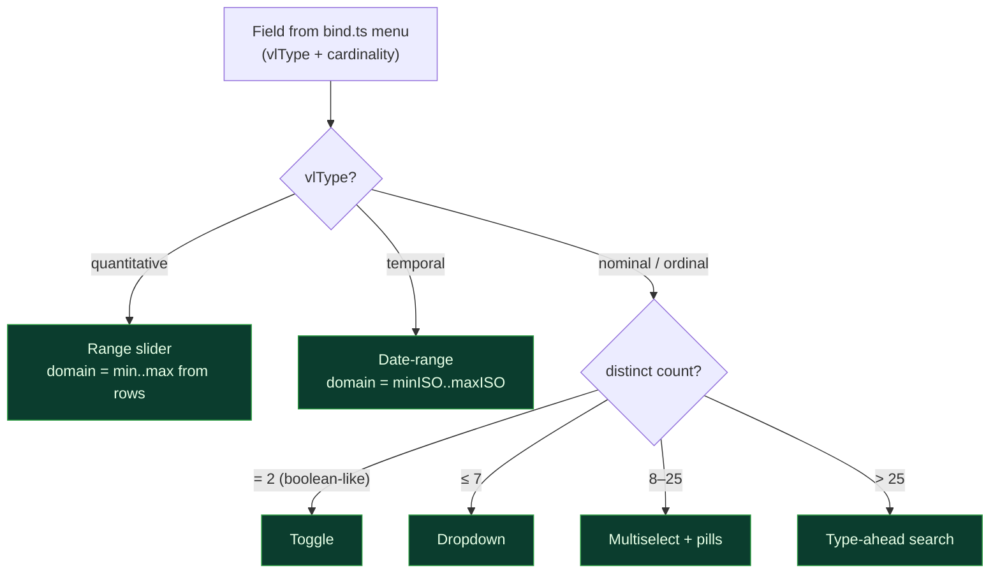
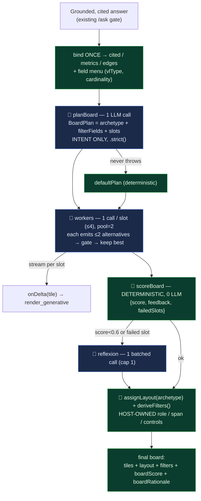

# Query-Adaptive Dashboards in Generative Studio — Technical Design

**Audience:** pharma R&D stakeholders + the build team · **Status:** design, pre-build ·
**Date:** 2026-07-14 · **Author:** solution team

> **The one-line thesis.** Today Generative Studio composes *different charts* per query but always
> pours them into the *same flat grid with no filters*, so every board looks alike. This design makes
> the server compose a **purpose-built dashboard per query** — the right **layout archetype**, the
> right **charts**, and **filter controls derived from the data** — and then **rank candidate boards
> to pick the best one**, all without letting the model touch a single data value.

---

## 1. How to read this doc

The design is argued through five expert lenses; component decisions cite the lens that drives them.

| Lens | Who | The stake they defend |
|---|---|---|
| 🏛 **Architect** | Solution architect | Reuse the existing trust chain; add the least new surface. |
| 📊 **Viz/UX** | Data-viz + UX lead | The board *reads* like a dashboard: layout, variety, discoverable filters. |
| 🔬 **Evals** | MLOps / evaluation lead | "Best board" is measurable, explainable, and testable — not vibes. |
| 🛡 **Trust** | Security / governance lead | The model never emits a value, a style, a span, or a filter config. |
| 💊 **Domain** | R&D / PV SME | Boards answer real signal questions and stay grounded in cited evidence. |

**Decided vs open.** Everything in §7–§9 is *decided* (the user approved building the full
orchestrator). Open knobs are flagged inline (⚙). This doc is the *why*; the sibling implementation
plan is the *how*.

---

## 2. The problem & requirements

### 2.1 Why boards feel same-y (grounded in the code)

Generative Studio's lane is already sound: the LLM emits an **encoding-only chart IR**, a
deterministic **Draco-lite critic** gates it, and a trusted compiler binds every value from
already-cited graph nodes. Charts *do* vary by query. Three gaps make the *dashboard* feel static:

1. **No layout.** Every board is one flat grid — `repeat(auto-fill, minmax(320px,1fr))`
   (`web/src/generative/GenerativeStudio.tsx:273`). No KPI row, hero, spans, or archetype. Identical
   *shape* every time reads as "same dashboard" even when the charts differ.
2. **No filter controls.** Filtration is cross-filter-by-mark-click only (`filterStore.ts`
   `narrowDatasets` takes an id list). No dropdowns, ranges, date pickers, facets, or search — the
   thing users mean by *"filtration like any dashboard must have."*
3. **No "best board" selection.** The critic is a per-tile accept/reject gate; there is no candidate
   generation and no board-level score, so nothing "finds the best visuals."

### 2.2 Functional requirements

- **F1 — Query-adaptive layout.** Different questions produce different, purpose-fit board layouts.
- **F2 — Adaptive charts.** The right marks/encodings per analytical intent (already largely met).
- **F3 — Derived filter controls.** A filter rail with the right control per field (dropdown / range /
  date / search), auto-derived from the data.
- **F4 — Best-board selection.** Generate candidates, score them, pick the best, and *explain why*.
- **F5 — Cross-filter + predicate filters compose.** Clicking a mark and setting a control both work,
  and together.

### 2.3 Non-functional & constraints

- **NFR-Trust (hard).** The model emits **encoding/intent only**. Layout, filter configs, `params`,
  `config`, and every data value are **host-owned**. `.strict()` zod fails-parse on any violation.
- **NFR-Grounded.** A board is drawn only on a grounded, cited answer; a refusal draws nothing.
- **NFR-Latency.** The local `claude` CLI is ~30s/call. A multi-call orchestrator must stream and cap.
- **NFR-Read-only.** No graph writes; the FAIR canvas stays byte-identical.
- **NFR-Stack.** 3-workspace monorepo, zod split (bff v4 / shared plain-TS / web v3).

---

## 3. Top creative dashboards → a codifiable layout vocabulary

We surveyed design-led product dashboards and best-in-class BI tools, then distilled the recurring
structures into **archetypes the server can select from**. The academic anchor is **Bach et al.,
*Dashboard Design Patterns* (IEEE VIS 2022)** — a systematic review of 144 dashboards. The
practitioner thesis across Stripe/Linear/Vercel write-ups is consistent: *restraint + interaction
density + one accent colour + progressive disclosure*, and *users scan (F-pattern), so anchor the
hero top-left and keep to ~5–9 core elements*.

### 3.1 What the admired dashboards do

| Product | Standout pattern | Why it's admired |
|---|---|---|
| **Stripe** | Hero "north-star" metric + column of secondary KPIs; detail one click away | Monochrome + single accent; restraint as the point |
| **Linear** | Sidebar + dense keyboard-driven cards | "Sparse visually, interaction-dense"; instant transitions |
| **Vercel** | Blueprint grid; KPI strip + clean small multiples | High-contrast, one colour doing all the work |
| **Observable Framework** | Dashboards-as-code; grid of bespoke small multiples | Max chart variety; *code owns the layout* (our closest sibling) |
| **Tableau / Power BI** | Free-form/grid canvas + "Show Me" chart suggestion | Cross-filter/highlight, drill-down/through by default |
| **Superset** | Coordinated multi-view | Best-in-class selection-sync across a board |
| **Grafana** | Time-series panel grid | Best-in-class time controls + URL-persisted state |

> ⚠️ Award-gallery boards (Awwwards/Dribbble) optimise for *aesthetic impact*, not analytical
> density — we borrow their **motion/variety vocabulary**, not their information architecture (📊).

### 3.2 The eight archetypes (the server's palette)

| Archetype | Grid recipe (12-col mental model) | The server picks it when… |
|---|---|---|
| **KPI-grid** | Row of 4–6 stat cards, then 2–4 charts | Default "are we on track?"; one subject, mixed measures |
| **Hero-rail** | One dominant chart (8-col) + supporting rail (4-col) + KPI strip | One trend dominates (a rate over time, an active-entity curve) |
| **Bento** | Asymmetric tiles, size ∝ importance, ≤2 heroes | Heterogeneous content; exec "wow" board |
| **Small-multiples** | Repeat one encoding across a categorical facet | Compare the same metric across members of one KG dimension |
| **Master-detail** | Overview list/table → detail bound to selection | Entity exploration — pick a node, inspect its neighbourhood (KG-native) |
| **Analytic-grid** | Uniform grid + global filter bar, cross-filter on | Multi-measure exploration (the BI default; our current-ish behaviour) |
| **Narrative-scroll** | Vertical scroll interleaving text + charts | Explanatory/report output for stakeholders |
| **Embedded-mini** | Compact cards / sparklines | KPI retrieval, tiles embedded elsewhere |

**The build implements the first six** (narrative-scroll and embedded-mini are noted follow-ons).
Bento's rule — *tile size reflects data **importance**, not volume; ≤2 hero tiles* — becomes a
constraint in `assignLayout`.

---

## 4. The filtration taxonomy — and the rule that makes it free

### 4.1 The taxonomy every strong dashboard has

Anchored in NNG's filtering guidance plus Power BI / Grafana docs.

| Pattern | What it is | Where it lives / best practice |
|---|---|---|
| **Global filters** | One control set constrains every widget | Top bar or left rail; keep few + high-level |
| **Cross-filter / brush** | Select marks in one chart → others narrow/dim | Power BI *filter* removes vs *highlight* dims; Superset syncs board-wide |
| **Drill-down / through** | Expand a hierarchy in place / jump to a filtered detail page | Down = same visual; through = master-detail |
| **Faceted filters** | Several independent category filters, ideally with counts | NNG: 25–50% faster tasks vs search alone |
| **Date/time-range** | Absolute + relative window | Grafana model: presets + custom + URL state |
| **Filter chips + clear-all** | Applied filters as removable tokens | Show selected values *outside* the dropdown |
| **Type-ahead search** | Search box inside a large value list | Once a list exceeds ~7–10 items |
| **Persistence** | Encode filter/time state into a shareable URL | Deep-linking & reproducibility |

### 4.2 The cardinality→control rule (the highest-leverage KG bridge) 🔬🛡

A field's **distinct-count (cardinality)** and type determine the *right* control. **Our
`bind.ts` field menu already carries `vlType` + `cardinality` per field** — so the server *derives*
the correct control deterministically. **No LLM guess, and the model never authors a filter.**

| Field profile | Control the server emits |
|---|---|
| Boolean / 2 values (`flagged`) | Toggle |
| Categorical ≤7 distinct (`kind`) | Dropdown (single) / checkboxes (multi) |
| Categorical 8–25 distinct | Multiselect with pills |
| Categorical >25 (high-cardinality `label`) | Type-ahead search + multiselect |
| Continuous numeric (`degree`, `prr`, `ror`) | Range slider + numeric inputs |
| Date/time | Relative presets + absolute range |

*Green = host-derived, never model-authored.*

---

## 5. State of the art — AI-driven dynamic dashboards (2024–2026)

### 5.1 Generative-BI products (text→dashboard)

Every serious product leans on a **governed semantic layer** to make NL→viz reliable. **For us, the
knowledge graph schema *is* that semantic layer — a structural advantage.**

| Product | What it does | Known limit |
|---|---|---|
| **Amazon Q in QuickSight** | NL authoring of visuals/calcs, exec summaries, story gen | Fewer chart types; AWS-centric; per-question pricing |
| **Power BI Copilot** | NL→visual, summaries, Q&A gen from the semantic model | Requires Fabric/Premium licensing |
| **Tableau Pulse + Agent** | Auto driver/trend/outlier detection + NL explanations; richer charts conversationally | Metric-centric; Agent somewhat separate from the main canvas |
| **ThoughtSpot Spotter/Sage** | Search-/agent-driven analytics, live query, HITL governance | Requires well-modeled, clean, business-named data |
| **Looker + Gemini** | NL → Looker visuals from LookML; BI/dashboard agents | Tied to LookML modeling |

### 5.2 Chart recommendation — how to pick the "best" visual 🔬

Two lineages we adopt server-side:
- **Perceptual effectiveness** — Cleveland-McGill (1984) ranked encodings (position > length > angle
  > area > colour); Mackinlay's APT (1986) operationalised *expressiveness + effectiveness*. This is
  the scoring backbone. Tableau's "Show Me" descends directly from it.
- **Constraint-based ranking** — **Draco / Draco 2** encode viz knowledge as hard + soft (learnable,
  weighted) constraints over facts; hard = validity, soft = ranking. **Our `critic.ts` is already a
  Draco-lite ranker** — we extend it to the board level.
- Learned recommenders (DeepEye, Data2Vis, VizML) exist but add model-serving weight we don't need.

### 5.3 Automatic layout + multi-agent composition

- **MultiVision** (VIS'21) scores single charts then composes coordinated views. **DashBot** (VIS'22)
  uses RL to *select* charts for insight coverage. **DMiner** (2022) mines layout patterns
  ("dashboard-by-example").
- **Data-to-Dashboard** (arXiv 2505.23695, 2025) is the most on-point: staged specialist agents
  (profiler → analysis generator → **Evaluator** (5-dim scoring) → **Self-Reflector** (Reflexion)),
  then a three-expert consensus picks viz types. It candidly reports incomplete chart coding — a
  caution we heed by keeping our compiler deterministic.
- **Anthropic, *Building Effective Agents*** names our two patterns: **Orchestrator-Workers**
  (decompose → delegate → synthesise) and **Evaluator-Optimizer** (generator + critic vs a rubric),
  explicitly composable. **"Pick the best board" *is* the evaluator-optimizer loop.**

---

## 6. The five approaches (and why we compose them)

| # | Approach | Reliability | Creativity | Latency | Best role |
|---|---|---|---|---|---|
| 1 | **Deterministic rule/constraint recommender** (Draco/Show-Me) | ★★★★★ | ★★ | ★★★★★ | Server-side **validator/ranker** (non-negotiable) |
| 2 | **Schema-constrained single-pass IR** | ★★★ | ★★★★ | ★★★★ | **Fast path** for single-chart / quick asks |
| 3 | **Candidate-and-rank** (evaluator-optimizer) | ★★★★ | ★★★★ | ★★★ | The **"best visuals"** promise |
| 4 | **Orchestrator-workers** board composer | ★★★★ | ★★★★★ | ★★ | **Full auto-generated dashboards** |
| 5 | **Retrieval / template** "dashboard-by-example" | ★★★★★ | ★★ | ★★★★ | Governed, repeatable R&D board types |

**Recommendation — the composite.** These are not rivals; they *layer*:

- **#1 always** — the Draco-lite critic gates every generated chart and scores the board. Determinism
  where a regulated pharma context needs trust (🛡🔬).
- **#2 stays** as the opt-in fast path (`?compose=generative`) and the orchestrator's fallback.
- **#3 inside the workers** — each worker emits ≤2 chart alternatives and keeps the higher-scoring
  one; the board critic then ranks the whole. This is candidate-and-rank *without* N× full-board cost.
- **#4 is the new board mode** (`?compose=board`) — a planner picks the archetype + slots, workers
  fill them, the board critic scores, one Reflexion round repairs.
- **#5 as a follow-on** — curated pharma R&D board templates the planner can retrieve (out of this build).

This is exactly what Part B builds.

---

## 7. Recommended architecture — the orchestrator

*Blue = LLM (intent only). Green = trusted host (owns every value, style, span, and filter).*

**Latency.** Three serial LLM phases × ~30s → worst case ≈ 90–120s for the *board* (the answer text
already rendered). Mitigations are structural, not hopeful: **per-slot streaming** (first tile ≈ 60s),
worker **concurrency 2**, **one batched** Reflexion, a hard **`budgetMs` ceiling** with graceful
partial return, and skipping the planner (`defaultPlan`) when the field menu is tiny.

---

## 8. The trust seam — what the model may and may not do 🛡

This is the crux for a regulated R&D setting. The trust boundary is unchanged in spirit and *widened
in coverage*: layout and filters join `config`/`params`/`data` as host-owned.

```mermaid
flowchart LR
  subgraph M["🧠 MODEL — proposes INTENT only"]
    m1["archetype hint"]
    m2["which fields to filter (names)"]
    m3["per-slot chart intent + encoding IR"]
  end
  subgraph H["🛡 TRUSTED HOST — owns everything that renders"]
    h1["every data value (bind from cited nodes)"]
    h2["layout role + span (assignLayout)"]
    h3["filter control kind + options (deriveFilters)"]
    h4["selection params + chart config (compileTile)"]
    h5["KPI numbers (host aggregate)"]
  end
  M -->|".strict() zod<br/>fail-parse on any host key"| H
  classDef llm fill:#1c2a4a,stroke:#5b8def,color:#e6f0ff;
  classDef host fill:#0b3d2e,stroke:#2ea043,color:#e6ffe6;
  class m1,m2,m3 llm;
  class h1,h2,h3,h4,h5 host;
```

| Concern | Guard |
|---|---|
| Planner emits a `span`/`config`/value | `boardPlanSchema.strict()` — fails parse; `role`/`span` set only by `assignLayout` |
| Filter kind/options from the model | `deriveFilters` reads distinct values from bound rows; the plan supplies only field *names* ⊆ menu |
| KPI number from the model | KPI is a host aggregate over bound rows; not expressible in the chart IR |
| Board on a refusal | Orchestrator runs inside the existing grounded gate; refusal draws nothing |
| Graph write / FAIR drift | New files import only bind/LLM/pure helpers; `WHERE NOT n:Safety` untouched |

---

## 9. How "best board" is measured (not vibes) 🔬

`scoreBoard(tiles, plan, fieldMenu)` is **deterministic, no LLM**, and returns a score + structured
feedback + `failedSlots`. It combines:

- **Per-tile appropriateness** — the existing Draco-lite `scoreTile` (perceptual-effectiveness rules).
- **Intent coverage** — every planned slot produced a tile.
- **Mark diversity** — penalise an all-identical-marks board (the "same chart" complaint, quantified).
- **Redundancy** — penalise two tiles with identical mark+encoding.
- **Layout balance** — sane KPI-to-detail ratio for the archetype.
- **Filter completeness** — each requested filter field resolves to a real control.

`failedSlots` is the *structured input* to the single Reflexion round — the loop re-prompts only what
failed, then stops (cap 1). The final board carries `boardScore` + a `boardRationale` string ("why
this board"), surfaced in the UI so a stakeholder sees the justification, not a black box.

---

## 10. Design critique — red-teaming our own approach

| # | Risk | Honest assessment | Mitigation |
|---|---|---|---|
| C1 | **Latency** (3 serial LLM phases) | Real. A full board can take ~2 min. | Per-slot streaming (first paint ~60s), concurrency, budget ceiling + partial return, `?compose=generative` fast path stays. Set expectations in the UI (a "composing your board…" progressive state). |
| C2 | **Layout-engine complexity** | A general constraint solver would be a tar pit. | We **don't build one**. Six fixed archetypes → a pure role/span *table*; reuse `DashboardCanvas`'s proven 2-col span grid. |
| C3 | **Filter × cross-filter interaction** | Two filter systems can corrupt each other. | Two *separate* pure stores, one defined compose order `narrowDatasets(applyControls(...))`, a dedicated intersection test. |
| C4 | **Planner picks a poor archetype** | The model may mis-route. | The archetype is a *hint*; the board critic + Reflexion catch a bad board; `defaultPlan` is a safe floor. |
| C5 | **Over-trust of "best"** | A high score ≠ a good answer. | Score is *explained* (`boardRationale`), the board stays labelled **exploratory, not certified**, and graduation to certified stays a human HITL step (follow-on). |

**Closing the gaps.** C1 and C5 are the ones a reviewer will press on. C1 is mitigated but not
eliminated — this is why the fast path stays and why we stream. C5 is a *feature*: the lane is
explicitly exploratory; nothing here bypasses the existing human-in-the-loop certification path.

---

## 11. Honest scope

**In:** query-adaptive layout (6 archetypes), host-derived filter controls, the planner→workers→
board-critic→1-Reflexion orchestrator, candidate-and-rank via per-slot alternatives + board scoring,
a KPI card, and the filter rail — behind an opt-in `?compose=board` mode with the single-pass lane
preserved as the fast path/fallback.

**Out (named, not hidden):** grammar-constrained decoding (unavailable on the subscription CLI);
new grounding-node selection; graph writes; a constraint-solver layout engine; a vision-judge LLM;
narrative-scroll/embedded-mini archetypes; template retrieval (#5); and tile→certified graduation
(exists, unchanged, a separate HITL follow-on).

---

## 12. Source ledger

**Layout / design:** Bach et al., *Dashboard Design Patterns*, IEEE VIS 2022
(arxiv.org/abs/2205.00757; catalog dashboarddesignpatterns.github.io) · datawirefra.me dashboard
layouts · pencilandpaper.io dashboards · setproduct.com dashboard UI · mantlr.com &
pixeldarts.com Stripe/Linear/Vercel · 925studios.co SaaS examples · awwwards.com data-viz.
**Filtration:** nngroup.com filter categories & values · Microsoft Learn (Power BI interactions,
drillthrough) · Grafana docs (URL variables / time) · pencilandpaper.io enterprise filtering ·
uxmovement.com filter components.
**AI/SOTA:** AWS Amazon Q in QuickSight GA · querio.ai NLQ comparison · Tableau Pulse help +
2025 features · Tableau Show Me help · Draco 2 (ar5iv 2308.14247) · VizML (CHI'19) · MultiVision
(2107.07823) · DashBot (PubMed 36179003) · DMiner (2209.01599) · Data-to-Dashboard (2505.23695) ·
Anthropic, *Building Effective Agents*. Foundations: Cleveland & McGill 1984; Mackinlay APT 1986.

*Confidence: strongest on the peer-reviewed chart-recommendation and agent-pattern lineage; weaker
(vendor-marketed) on product feature-sets — re-verify licensing/capability before committing to a
client deck.*
