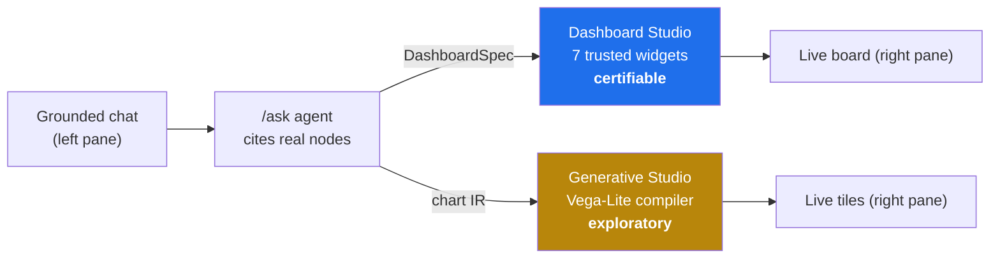
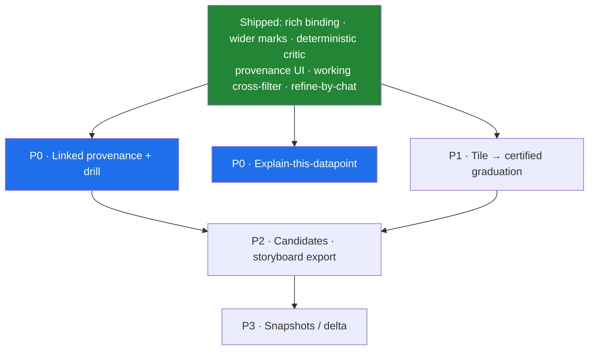

# Dashboard Studio & Generative Studio — a working guide

> Two split-view surfaces where a grounded chat on the **left** paints a live, interactive
> canvas on the **right**. Same trust rules as every other beat: **every mark is bound to a
> cited graph node, or nothing is drawn.** This guide explains what each Studio is, the new
> canvas behaviour, a bank of **sample prompts that actually ground**, and what to build next
> to get the most out of Generative Studio.
>
> Companion pages:
> - [`DEMO_QUERIES.md`](./DEMO_QUERIES.md) — ready-to-paste Conversation-beat queries as user stories.
> - [`FEATURES_GUIDE.md`](./FEATURES_GUIDE.md) — the full feature tour (beats + F1–F8).
> - [`GENERATIVE_DASHBOARDS_Technical_Design.md`](./GENERATIVE_DASHBOARDS_Technical_Design.md) — the design/trust model.
>
> _Accurate as of the codebase on 2026-07-14. Paths are relative to `rnd-trust-graph/`._

---

## Table of contents

1. [The two Studios at a glance](#the-two-studios-at-a-glance)
2. [The split view & the pop-out canvas](#the-split-view--the-pop-out-canvas)
3. [Grounding note — read before you demo](#grounding-note--read-before-you-demo)
4. [Sample prompts — Dashboard Studio](#sample-prompts--dashboard-studio)
5. [Sample prompts — Generative Studio](#sample-prompts--generative-studio)
6. [What a Generative tile now tells you](#what-a-generative-tile-now-tells-you)
7. [Prove the trust boundary — refusals](#prove-the-trust-boundary--refusals)
8. [What to build next for Generative Studio](#what-to-build-next-for-generative-studio)
9. [Quick reference](#quick-reference)

---

## The two Studios at a glance

Both take a grounded answer and turn it into a live canvas. The difference is **how much
freedom the model has over the visual**, and that in turn sets whether the result can be
*certified*.

| | ✨ **Dashboard Studio** | ✨ **Generative Studio** |
|---|---|---|
| **What the model does** | picks tiles from a **fixed registry** of 7 trusted widgets | composes **arbitrary Vega-Lite** chart encodings |
| **Model emits** | a `DashboardSpec` (which widgets, which cited nodes) | a compact **chart IR** (mark + encoding), never data values |
| **Who builds the visual** | trusted server maps each widget → a grounded render primitive | trusted server compiler turns IR → locked Vega-Lite |
| **Trust posture** | can be **certified** (green badge) | **⚗ exploratory** (dashed pill) + a quality score |
| **Best for** | the repeatable, review-ready board | open-ended "chart this however works best" |
| **Data binding** | server-side, from cited nodes only | server-side, from cited nodes only — over three datasets (`cited` / `metrics` / `edges`) |
| **Where** | `web/src/dashboards/DashboardStudio.tsx` | `web/src/generative/GenerativeStudio.tsx` |

> [!NOTE]
> The **7 Dashboard widgets** are: `coverage-header` (coverage % + gaps), `evidence-ledger`
> (Known / Missing / Conflicting), `stat-chart` (PRR/ROR bars), `hero-flow`
> (AE→Drug→Target→Pathway), `evidence-subgraph` (force-graph of cited nodes + real edges),
> `citation-chips` (clickable cited nodes), and `metric` (a single KPI: faithfulness,
> cited-count, or coverage). The model can only *arrange* these — it can never inject a value.

---

## The split view & the pop-out canvas

Each Studio is **chat left, canvas right**. Recent change: the companion **knowledge graph is
now hidden by default inside the Studios** — the board/tiles canvas is the focus — and pops out
on demand.

- **🕸 Graph** (top-right of the chat pane) — opens the companion knowledge graph in a
  full-screen overlay. **Esc** or **⤧ Close graph** dismisses it. It is *hidden* until you ask
  for it, so the Studio canvas isn't competing with a second graph.
- **⤢ Full screen** (on the board/tiles canvas) — pops the Studio canvas itself to a
  full-viewport overlay; **Esc** or **⤧ Exit** restores the split view. Good for presenting.
- The Conversation beat is unchanged — there the companion graph stays inline as before.

> [!TIP]
> Demo flow: keep the graph hidden, drive the board with prompts, then hit **⤢ Full screen** to
> present the finished canvas. Only pop **🕸 Graph** when someone asks "where does this come from?"
> — click a cited node in the graph and it becomes the chat's context.

---

## Grounding note — read before you demo

> [!IMPORTANT]
> The Studios cite from the **FAIR (non-safety) node space**. The reliably-grounded story is the
> **atrial-fibrillation / ibrutinib / BTK** signal (verified live: cites `AE-AFIB`,
> `STAT-BTK-AFIB`, `DRUG-BTK`, `TGT-BTK`, `GA-OT-BTK-AFIB`, `LIT-PMID-25103805`,
> `CT-NCT01578707`, subjects `PT-201/202/203`). The **myocarditis / checkpoint-inhibitor**
> story lives largely in the **safety** substrate and is the material for the *Safety* canvas —
> it may not cite in the Studios. **If a canvas stays empty, the topic isn't in the cited set —
> rephrase toward the atrial-fibrillation signal, its mechanism, its subjects, or its evidence.**

Two more rules that decide whether anything renders:

- **Ask a direct, specific question** ("What do we know about X? Use the graph."). Vague "build
  me some charts" phrasing makes the agent over-explore and sometimes never finalize → nothing draws.
- **Grounded-only is sacred.** A refusal or a fallback draws an **empty** canvas on purpose.
  That's the feature, not a bug (see [refusals](#prove-the-trust-boundary--refusals)).

The full grounded node set for the AFIB signal (what a good prompt will cite)

| Node | What it is |
|---|---|
| `AE-AFIB` | Atrial fibrillation (MedDRA 10003658) |
| `STAT-BTK-AFIB` | Disproportionality: PRR 5.1, ROR 5.5, χ²=63.0, CI 3.4–7.6, 44 cases |
| `DRUG-BTK` | BTK inhibitor (ibrutinib) — the suspect drug |
| `TGT-BTK` | Bruton tyrosine kinase (the target) |
| `GA-OT-BTK-AFIB` | Open Targets BTK↔AF genetic association (otScore 0.29) |
| `LIT-PMID-25103805` | Literature: ibrutinib & new-onset AF |
| `CT-NCT01578707` | Clinical trial: ibrutinib in relapsed CLL (Phase 3) |
| `PT-201`, `PT-202`, `PT-203` | Subjects reporting the event |
| `ONTO-MEDDRA-27` | MedDRA v27.0 ontology slice |

---

## Sample prompts — Dashboard Studio

Paste into the **left** chat of Dashboard Studio. Each is annotated with the widgets it tends to
trigger. All are grounded — the board's tiles bind only to the cited nodes above.

**1 · The full evidence board (the money prompt).**
> "What do we know about the atrial fibrillation signal? Which subjects and evidence support it? Use the graph."

*Builds:* `coverage-header` → `hero-flow` (Target→AE→Signal) → `stat-chart` (PRR/ROR) →
`evidence-ledger` (Known/Missing/Conflicting) → `citation-chips`. Verified live: `source: llm`,
`certified: [stat-chart, evidence-ledger]`, `isFallback: false`.

**2 · Just the numbers.**
> "Show the disproportionality statistics for the atrial fibrillation signal — PRR, ROR, chi-square and case counts."

*Builds:* a `stat-chart` of `STAT-BTK-AFIB` plus a `metric` KPI. Good for "one tile, cited."

**3 · Mechanism as a flow.**
> "Trace the mechanism from the BTK inhibitor to atrial fibrillation — drug, target, and the genetic association."

*Builds:* `hero-flow` (`DRUG-BTK → TGT-BTK → AE-AFIB`) + `evidence-subgraph` of the cited nodes.

**4 · Evidence sufficiency.**
> "For the atrial fibrillation signal, what evidence is known, what is missing, and what is conflicting?"

*Builds:* `evidence-ledger` front-and-centre + `coverage-header`. Shows the honest-gaps story.

**5 · The relational picture.**
> "Draw the subgraph of everything connected to the atrial fibrillation adverse event — subjects, literature, trial, target."

*Builds:* `evidence-subgraph` (force-graph of cited nodes + real edges) + `citation-chips`.

**6 · Follow-up / live merge (Phase 2).**
> _(after prompt 1)_ "Now add the clinical trial and the subjects to the board."

*Does:* merges/patches tiles **in place** on the existing board (append-only), rather than
redrawing. Then hit **💾 Save** to persist, or **⤢ Full screen** to present.

---

## Sample prompts — Generative Studio

Paste into the **left** chat of Generative Studio. Here the model chooses the *chart type* — it
emits a Vega-Lite IR the server compiles into a locked, sandboxed tile. Every tile is marked
**⚗ exploratory** (graduation to certified is [next on the roadmap](#what-to-build-next-for-generative-studio)).

**1 · Let the model choose.**
> "Chart the cited evidence for the atrial fibrillation signal — pick the best marks yourself. Use the graph."

*Does:* streams several `render_generative` tiles (one shared run), each bound to cited rows.
Verified live: 5 tiles, `source: llm`, `estimated: false`.

**2 · A specific comparison.**
> "Make a bar chart of the disproportionality metrics (PRR, ROR, chi-square) for the atrial fibrillation signal."

*Does:* a single bar tile bound to `STAT-BTK-AFIB` fields.

**3 · Subjects view.**
> "Visualize the subjects reporting atrial fibrillation and how they connect to the evidence."

*Does:* the model picks an appropriate mark (point/bar) over the cited subject + evidence nodes.

**4 · Cross-filter story.**
> "Chart the cited nodes for the atrial fibrillation signal by type, so I can click one type and filter the rest."

*Does:* multiple tiles that **cross-filter**. Click any mark — including an *aggregated* bar, e.g.
the χ² bar or a "Drug" category — and every sibling tile narrows to the nodes behind it, across
**all three** datasets. A **"filtered to N nodes ✕"** chip appears in the canvas header; click it to
clear. Verified live: selecting the χ² bar (node `STAT-BTK-AFIB`) narrowed the metrics tile 5→4
rows, the edges tile 13→2, and both cited tiles to 1.

**5 · Chart the real numbers** (needs the rich binding — see below).
> "Compare the disproportionality metrics behind the atrial fibrillation signal. Use the graph."

*Does:* picks the **`metrics`** dataset and charts the actual PRR / ROR / χ² / case-count values
(not just node degree). Grouped or faceted bars, chosen by the model.

**6 · Prove it's safe.**
> _Click **🛡 how this is safe**_ on the tiles canvas.

*Shows:* the model only emits an encoding skeleton referencing a named dataset; the server binds
every value from cited nodes; the client renders through a locked vega-embed runtime (AST-only,
canvas, no export/view-source, deny-all loader).

---

## What a Generative tile now tells you

Every tile carries its own trust surface, so a reviewer never has to take the chart on faith.

| On the tile | What it means |
|---|---|
| **⚗ exploratory** (dashed pill) | LLM-composed, not certified. The state is carried by the **glyph and the dashed border**, not by colour alone — it still reads without colour vision (WCAG 1.4.1). A graduated tile shows **✓ certified** with a solid border. |
| **●●●○** quality meter | The **appropriateness score** from a *deterministic* design-rule critic that runs on the server (no LLM). It scores mark↔data fit — a line over a nominal axis, a 20-slice pie, a bare count — and a chart that scores below threshold is **never emitted**: it goes back for repair or is dropped. |
| **Provenance strip** | "Grounded in *N* cited nodes · *R* rows · fields: …" — the exact fields the chart encodes and the cited set it was bound from. Under an active cross-filter it reports what is **actually drawn** ("1 of 2 cited rows (filtered)"), never the stale compose-time count. |
| **🔍 Explain** | Opens the **lineage drawer**: the model's rationale for choosing this chart shape, the server-derived lineage (dataset, fields, cited node ids), and an **audit table of the exact rows the chart drew**. |

> [!NOTE]
> The **three bound datasets** are `cited` (one wide row per cited node, including its parsed
> numeric attributes), `metrics` (tidy-long — one row per numeric attribute, the table to chart
> PRR/ROR/case counts), and `edges` (the relationships). A tile picks **one**, and its field refs
> are validated against *that* dataset's fields.

> [!IMPORTANT]
> The chart **theme and the selection are owned by the host, never the model.** Neither `config`
> nor `params` is representable in the model-facing IR, so a tile cannot restyle itself, hide an
> axis, smuggle a URL through a theme, or name a signal. The compiler attaches the point selection
> to every tile itself — which is why cross-filter works at all; when it was left to the model,
> **zero of four** live tiles ever declared one.
>
> The palette is Okabe-Ito (colourblind-safe), with a **darkened variant for light surfaces**:
> measured against white, four of Okabe-Ito's eight hues fail WCAG's 3:1 minimum for a chart mark
> (its yellow lands at **1.32:1** — effectively invisible). Each tile measures the surface it is
> actually painted on rather than trusting a theme flag, and a test enforces the contrast floor.

---

## Prove the trust boundary — refusals

Run these in **either** Studio to show the canvas stays **empty on purpose** — a generic chatbot
would confabulate; this one refuses because it can't cite.

> "What corticosteroid dose is recommended for checkpoint-inhibitor myocarditis?"

> "What are the adverse events for aspirin?"

*Does:* `NOT_IN_GRAPH` refusal → no tiles, no board. This is the demo's money moment: contrast it
directly with Dashboard Studio prompt 1, which *is* answerable and *does* draw.

---

## What to build next for Generative Studio

Generative Studio ships the hard part — a trusted IR→compiler→sandbox pipeline that lets the LLM
compose *arbitrary* charts without ever touching data. A four-phase upgrade has since landed; the
rest is about **conversational refinement, linked interaction, and trust-graduation**.

### ✅ Shipped

| Capability | What it does |
|---|---|
| **Rich data binding** | Node attributes are parsed into typed columns and exposed as three datasets (`cited` / `metrics` / `edges`). Tiles now chart the **real numbers** — PRR, ROR, χ², case counts — not just `degree`/`kind`. This was the substance unlock: grounding the model in a real semantic layer is the single biggest accuracy lever. |
| **Wider mark & encoding range** | Added `arc` and `boxplot` marks and the `theta` / `column` / `row` / `xOffset` channels — pies, faceted small-multiples and grouped bars are now expressible. |
| **Deterministic chart-quality critic** | A Draco-lite design-rule pass scores every chart *without an LLM* (so it costs no latency), auto-fixes the trivially-fixable, and **gates emission**: a low-scoring chart is routed into the repair round with specific feedback, or dropped. The score is a **gate, not a ranking** (every surviving tile scores at/near 1.0), so it is stated as a fact in the Explain drawer rather than shown as a per-tile meter. |
| **Provenance-first tile UI** | Non-colour trust pill, a provenance strip, and the **🔍 Explain** lineage drawer with the audit table of the exact bound rows. Host-owned, contrast-safe theme on light and dark surfaces. |
| **Working cross-filter** | Host-attached point selection on every tile; clicking any mark (including an aggregated bar) narrows **all three** datasets, with a clearable filter chip. |
| **Refine-a-tile by chat** | Edit any tile conversationally — preset chips (*Swap mark · Facet by kind · Color by kind · Bin values*) or a free-text box (e.g. "chart the numeric signal values") — in **one** read-only LLM round. The refined tile keeps its id and re-binds from its **own** cited nodes (never a new grounding), passes the same schema/critic/compiler gate as compose, and swaps in place; a per-tile **↩ Restore** walks the change back. A refine the model can't express leaves the prior chart standing. |

### ⏳ Next

| Pri | Capability | Why it matters | Rough effort |
|---|---|---|---|
| **P0** | **Linked provenance panel + drill breadcrumb** | the cross-filter narrows the charts; surface the selected nodes' *evidence* beside the board, and give the drill an "up" path | M |
| **P0** | **Explain-this-datapoint** | click a mark → a templated *grounded* question about that node, routed through the existing ask path (no new answer path, no new compute) | M |
| **P1** | **Tile → certified graduation** | a human-in-the-loop path to promote a validated exploratory tile to certified (reusing the Send→Review empty-ops HITL), closing the exploratory→trusted gap — the certified pill already exists, this makes it reachable | M |
| **P2** | **Candidate charts on ambiguity** | when a question admits 2–3 good chart shapes, emit them as alternatives in the *same* compose (no extra LLM round) and let the user switch | M |
| **P2** | **Storyboard / narrative export** | order tiles into a case narrative, each with its provenance strip, and export to PDF/deck | M |
| **P3** | **Snapshot & delta for tiles** | pin a tile, recompute on a cadence, show what changed (bring Dashboard Studio's F9 snapshots/delta briefs to the generative lane) | M |

> [!TIP]
> With **refine-by-chat** shipped, the next highest-value builds are the two P0s — surfacing the
> cross-filter's selected evidence beside the board (**linked provenance**) and letting a mark click
> ask a **grounded question about that datapoint**. Both reuse the existing grounded ask path — no
> new answer path, no new compute.

---

## Quick reference

| Action | Where |
|---|---|
| Open a Studio | header ✨ **Dashboard Studio** / ✨ **Generative Studio** |
| Show the companion graph | **🕸 Graph** (chat pane) → **Esc** / **⤧ Close graph** to hide |
| Full-screen the canvas | **⤢ Full screen** (canvas) → **Esc** / **⤧ Exit** to restore |
| Save a board | **💾 Save** (Dashboard Studio canvas) |
| Audit a chart's rows | **🔍 Explain** (Generative Studio tile) → lineage drawer → **Esc** to close |
| See why a tile is safe | **🛡 how this is safe** (Generative Studio canvas) |
| Definitive live check | FinOps ledger `estimated:false` **and** non-empty `citedNodeIds` |

> [!CAUTION]
> Config/env or BFF code changes need a **real `:8787` restart** — `tsx watch` won't reload them.
> The reliable live proof is an AFIB-signal prompt returning a board/tiles with
> `isFallback:false` **and** `estimated:false` on the ledger.
