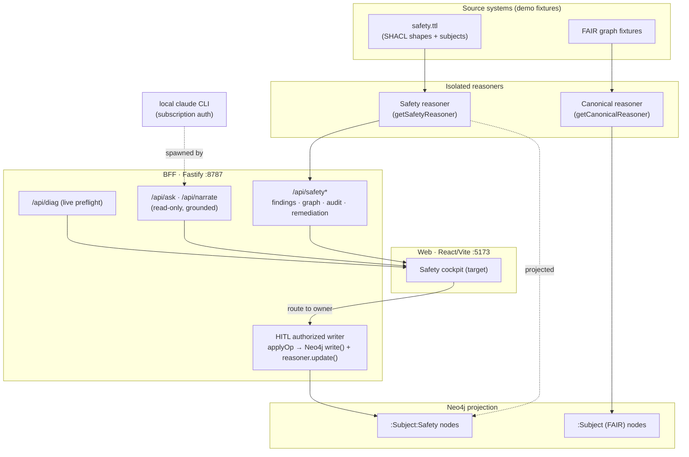
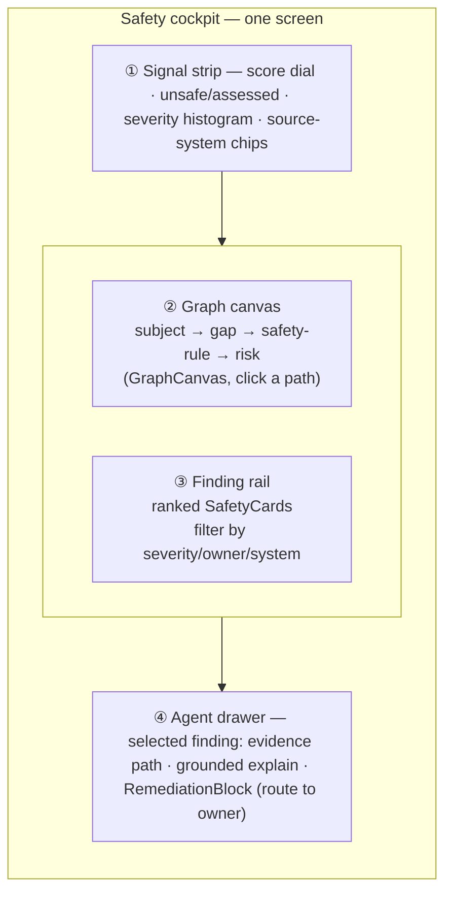
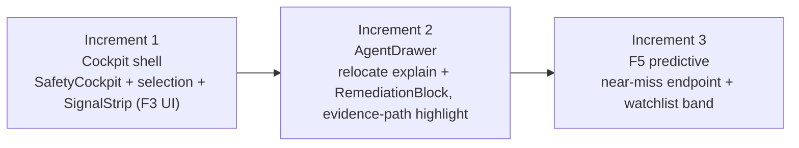

# UC4 Patient‑Safety Radar — Architecture & Front‑End Implementation Plan

> [!NOTE]
> This is the **build plan** that turns the [UX + AI design direction](UC4-SAFETY-UX-AND-AI.md)
> into concrete architecture and front‑end work. It is grounded in the **shipped**
> code — F1–F4 already run on the real stack — so it reads as *"here is the system,
> here is the cockpit that unifies it, here is what remains"*, not a greenfield fantasy.

**Badges — current build state (verified 2026‑07‑09):**


-2ea44f?style=for-the-badge)


---

## TL;DR — the verdict

- **The UI to build is a graph‑first *safety cockpit*** — one screen: a subject‑safety
  **graph canvas** (left/centre), a **signal strip** (population + severity, top), a
  **finding rail** (right), and an **agent drawer** (per‑finding remediation). Today those
  live as separate pieces behind a flat card list; the work is to **compose them into one
  cockpit**, not to build new backends.
- **The backend is done and correct.** Six `/api/safety/*` endpoints, two isolated
  reasoners, and the HITL authorized writer already exist and are tested. F5 (predictive)
  is the only feature needing new server work.
- **Trust is the moat, and it's already enforced** — every write goes through the HITL
  authorized writer, the agent path stays read‑only, the FAIR canvas stays byte‑identical,
  and F2 remediation is provably propose‑only. The plan's #1 rule: **do not regress these**.
- **Remaining effort is mostly front‑end integration** (the cockpit shell) + **one new
  feature** (F5). Estimated at **3 focused increments** (§6).

---

## 1. System architecture (what already exists)

The radar is **RDF‑canonical with a Neo4j projection**. Two *separate* reasoners keep FAIR
data and safety data from contaminating each other, and a single authorized writer is the
only path that mutates state.



### Data flow — a finding's life

1. **Detect** — `getSafetyViolations()` runs the 6 SHACL shapes over the *static* safety
   reasoner → `SafetyFinding[]` (riskType, subject, severity, owner, evidence path).
2. **Score** — `subjectsAssessed` from a fallback‑free Neo4j read; score = round(100·(assessed−unsafe)/assessed) → the 30/100 headline.
3. **Serve** — `/api/safety` (findings + score), `/api/safety/graph` (subject subgraph),
   `/api/safety/remediation` (F2 plans), `/api/safety/explain` (grounded per‑finding LLM).
4. **Act** — the cockpit routes a remediation via `/api/safety/remediation/route` →
   `enqueueItem()` → the HITL pending queue → `/api/hitl/apply` records a governed,
   reversible ChangeSet. **No patient data is fabricated** (F2 is propose‑only).

### The trust invariants (do NOT regress)

| Invariant | Where enforced | Why it matters |
|---|---|---|
| All writes via the **authorized writer** | `hitl/ops.ts` `applyOp` | Single audited mutation path; agent/MCP can't write |
| Agent/MCP stays **read‑only** | `ask/enforced.ts`, `--read-only` MCP, `/api/sparql` write‑guard | The LLM can *explain*, never *change* |
| FAIR canvas **byte‑identical** | `graph/queries.ts` `WHERE NOT n:Safety` | Safety nodes never leak into the FAIR readiness view |
| F2 remediation **propose‑only** | `safety/remediate.ts` + test invariant (empty ops) | Patient safety: approving records a decision, edits nothing |
| Grounded or **refuse** | narrator + `/ask` citation enforcement | No answer off the served evidence |

---

## 2. Front‑end design — the safety cockpit

**Problem with today's UI:** `SafetyRadarBeat.tsx` is a flat vertical list of `SafetyCard`s.
The rich subject subgraph we project is invisible; there's no population view and no single
place the eye lands. **Target:** a four‑region cockpit that answers *"where is it unsafe,
how bad across the population, and what do I do"* in one glance.



### Component tree (reuse first)

```text
SafetyCockpit                         (new shell — replaces the flat list)
├── SignalStrip                       (new — composes existing primitives)
│   ├── ScoreDial                     ← reuse StatChart / Sparkline (GroundedDiagrams)
│   ├── SeverityHistogram             ← reuse StatChart
│   └── SourceSystemChips             ← new, trivial
├── SafetyGraphCanvas                 ← reuse GraphCanvas (already fed by /api/safety/graph)
│   └── EvidencePathHighlight         ← reuse HopRail / EvidenceSubgraph
├── FindingRail
│   ├── FiltersRail                   ← reuse existing FiltersRail
│   └── SafetyCard[]                  ← existing (keep)
└── AgentDrawer                       (new — lifts current inline blocks into a focused panel)
    ├── GroundedExplain               ← existing /api/safety/explain wiring
    └── RemediationBlock              ← existing (F2, shipped)
```

> [!TIP]
> **~70% of the cockpit is composition of shipped components.** The genuinely new code is
> `SafetyCockpit` (layout shell + selection state), `SignalStrip`, and `AgentDrawer`
> (which mostly *relocates* blocks that already render). This is a layout/IA change, not a
> rewrite.

### Interaction model & states

- **Selection is the spine:** clicking a `SafetyCard` *or* a canvas path sets one
  `selectedFindingId`; the canvas highlights that evidence path and the drawer fills. One
  source of truth, no divergent panels.
- **States to design explicitly:** loading (skeleton dial + rail), empty (score 100/100 —
  celebrate, don't blank), degraded (`/api/diag` not live → show a "scripted mode" ribbon so
  the presenter is never surprised), and routed (finding shows "✓ routed to \<owner\>").
- **Motion:** the evidence path draws on when selected (draw‑on + flow‑along‑path, gated by
  the in‑app `MotionContext`, not the OS query — see [[jj-flowing-path-particles]]).

---

## 3. Feature build status & remaining work

| Feature | Backend | Front‑end | Status |
|---|---|---|---|
| **F1** Subject‑safety graph canvas | `/api/safety/graph` ✅ | `GraphCanvas` wired ✅ | **Shipped** — surfaces in cockpit §2 |
| **F2** Agentic remediate | `/api/safety/remediation*` ✅ | `RemediationBlock` ✅ | **Shipped** — propose‑only, tested |
| **F3** Fleet / cohort signal | `/api/safety` (score+counts) ✅ | needs `SignalStrip` composition | **Backend done, cockpit UI pending** |
| **F4** Grounded "Ask the radar" | `/api/ask` + `/api/safety/explain` ✅ | `AskDock` / explain ✅ | **Shipped** — now **live** (PATH fix) |
| **F5** Predictive / early‑warning | — | — | **Not started** (horizon) |
| **Cockpit shell** | n/a | `SafetyCockpit` + `AgentDrawer` | **Pending** — the integration work |

### F5 · Predictive tier (the only net‑new backend)

Scope it **honestly and small**: not ML training, but a **deterministic early‑warning
projection** — "subjects with N‑1 of the M conditions for a risk" (e.g. active prescription
+ missing allergy record but no rule‑fire *yet*). Reuses the SHACL shapes as near‑miss
templates; served as `/api/safety/predictive`; rendered as an amber "watchlist" band in the
`SignalStrip`. Keeps the grounded‑or‑refuse posture (every prediction cites the partial path).

---

## 4. Build sequence



1. **Increment 1 — Cockpit shell + F3 UI.** Highest impact, lowest risk: build
   `SafetyCockpit` layout + `selectedFindingId` state, compose `SignalStrip` from
   `StatChart`/`Sparkline` over the *existing* `/api/safety` payload. Delivers the
   population view and the graph‑first landing in one step.
2. **Increment 2 — AgentDrawer.** Lift the grounded‑explain and `RemediationBlock` into the
   focused drawer; wire canvas‑path ↔ card selection with the draw‑on highlight. No new
   endpoints.
3. **Increment 3 — F5 predictive.** New `/api/safety/predictive` (near‑miss over SHACL) +
   watchlist band + tests (including a "prediction cites a real partial path" invariant).

Each increment ends with the **standard gate**: typecheck (3 workspaces) → targeted BFF
tests (full suite hangs on CLI eval tests — run the subset) → live render‑proof → verify the
trust invariants in §1 still hold.

---

## 5. Risks & mitigations

> [!WARNING]
> **The static‑TTL / canonical‑reasoner split is a real constraint, not a bug.** Safety
> findings validate `safety.ttl` via the safety reasoner; `applyOp` targets the *canonical*
> reasoner (safety nodes absent). So **no ChangeOp can auto‑clear a finding or move the
> score** — this is *why* F2 is propose‑only. Any future "close the loop" feature (CSV
> round‑trip) must add a real source‑of‑record write path; do **not** fake it by mutating
> Neo4j alone (it would half‑apply and dangle the RDF).

| Risk | Mitigation |
|---|---|
| Cockpit regresses the flat‑list users know | Ship behind the existing beat; keep `SafetyCard` intact and reused |
| F5 reads as "made‑up predictions" | Deterministic near‑miss only; every item cites its partial evidence path |
| Overlay ops lost on persist | Any new overlay ChangeOp must be replayed in `store.ts` rebuildOverlay ([[jj-relationship-tags-feature]]) |
| Live‑mode surprises at the podium | `/api/diag` ribbon in the cockpit; `estimated:false` ledger check ([[jj-llm-not-active-path-fix]]) |

---

## Appendix — grounding

- Shipped endpoints (verified live): `/api/safety`, `/api/safety/audit`,
  `/api/safety/graph`, `/api/safety/remediation`, `/api/safety/remediation/route`,
  `/api/safety/explain`.
- Reuse inventory: `web/src/components/GraphCanvas.tsx`,
  `web/src/components/GroundedDiagrams.tsx` (`StatChart`, `EvidenceSubgraph`),
  `web/src/finops/Sparkline.tsx`, `web/src/components/HopRail.tsx`, the existing
  `FiltersRail`, and `web/src/beats/SafetyRadarBeat.tsx` (`SafetyCard`, `RemediationBlock`).
- Research basis: [UC4‑SAFETY‑UX‑AND‑AI.md](UC4-SAFETY-UX-AND-AI.md) (personas, SOTA survey,
  red‑team, F1–F5 specs).
