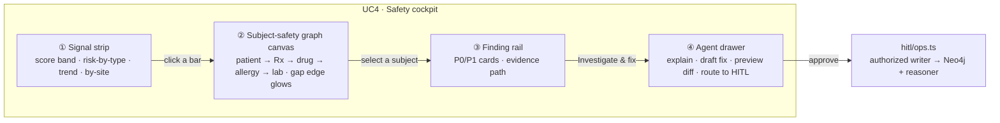
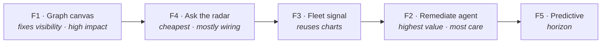

<div align="center">

# UC4 Patient‑Safety Radar — UX + AI Design Direction

**From a flat card list to a graph‑first, signal‑first, action‑first safety cockpit**


<sub>Companion interactive walkthrough → [`uc4-safety-ux-and-ai.html`](uc4-safety-ux-and-ai.html) · Demo script → [`UC4-DEMO-SCRIPT.md`](UC4-DEMO-SCRIPT.md)</sub>

</div>

---

## TL;DR

- **"I don't see SUBJ‑201…206 in Neo4j" is a *visibility* gap, not a missing‑data bug.** All 10 subjects are in Neo4j right now — proven live below. They're hidden from the FAIR graph canvas *on purpose*, and we never gave them their own visual surface.
- **The current safety beat under‑serves the use case**: it's a flat list of cards — no graph, no population signal, no chart, remediation is text only, and the score is all‑or‑nothing.
- **The industry pattern is clear**: risk dashboard → drill into the patient/site graph → agent drafts the fix → human approves ([CluePoints](https://cluepoints.com/what-we-do/risk-based-quality-management-rbqm/detection/), [Medidata](https://www.medidata.com/en/clinical-data-studio/), [ZS](https://medium.com/zs-associates/insights-at-scale-why-agentic-ai-is-the-next-frontier-for-data-management-in-pharma-a6b392b20db1)).
- **Five features close the gap** (F1–F4 chosen to build; F5 is the horizon). Each reuses code we already have and keeps every trust invariant.

> [!NOTE]
> Every number, subject id, and finding in this document is copied from the **live** `/api/safety` and `/api/safety/audit` responses captured while writing it — not invented. See [Grounding](#appendix--grounding-the-live-payload).

---

## 1. The data‑visibility answer (proof first)

The claim was "the subjects aren't in Neo4j." They are. The safety score is computed from a **hard, fallback‑free Neo4j read**:

```cypher
-- bff/src/safety/service.ts:382 — if the DB were empty this returns 0 and the score breaks
MATCH (s:Subject) RETURN count(DISTINCT s) AS n
```

Live, that endpoint returns `subjectsAssessed: 10`. The 10 subjects are physically present, tagged `:Subject:Safety`. They're absent from **exactly one** surface — the main FAIR graph canvas — and that exclusion is deliberate, to keep the FAIR readiness view byte‑identical:

```cypher
-- bff/src/graph/queries.ts:89 — the FAIR canvas intentionally omits safety nodes
MATCH (n) WHERE NOT n:Safety RETURN n
```

**To see the subjects right now**, run either query in Neo4j Browser:

```cypher
MATCH (s:Subject) RETURN s                     -- the 10 assessed subjects
MATCH (n:Safety)-[r]->(m) RETURN n, r, m        -- the whole subject‑safety subgraph
```

> [!IMPORTANT]
> So the real problem isn't the pipeline — it's the **UI**. We built a rich subject → prescription → drug → allergy → lab → referral → code graph in Neo4j and then never rendered it anywhere. That's the opportunity.

---

## 2. Why the current UI under‑serves the use case

`web/src/beats/SafetyRadarBeat.tsx` today is a vertical stack of styled `<div>`s: a big score number, an accordion of six finding cards each with an evidence‑path rail, a "How is this scored?" audit table, and a per‑finding "Explain" button. It's honest and grounded — but it answers only *"which individual records failed a rule."* It does **not** answer the questions the job actually asks:

| The job needs to answer… | Current beat | Gap |
|---|---|---|
| *Show me the patient and the broken relationship* | text rail, no graph | **no graph visual at all** |
| *Is this one site, or the whole cohort?* | six isolated cards | **no population / aggregation** |
| *Is it getting better or worse?* | single snapshot number | **no trend / time** |
| *Fix it — don't just tell me* | a remediation sentence | **text only, no action** |
| *Ask a question of the data* | — | **no grounded Q&A** |
| *How bad, really?* | `round(100·(A−U)/A)` | **P0 = P1 in the headline** |

Meanwhile **Beat 1 (FAIR radar, `web/src/beats/RadarBeat.tsx`) already ships the richer vocabulary** the safety beat lacks: an interactive `GraphCanvas` with readiness colouring and flowing‑particle paths, a readiness legend, confidence meters, and governance pills. The safety beat borrowed only the severity‑pill card idiom. **The redesign is largely "adopt Beat 1's canvas + our unused chart components for the safety subgraph we already projected."**

---

## 3. Multi‑persona design pass

Who stands in front of this screen, and what do they actually need from it?

| Persona | Their question | What the screen must give them |
|---|---|---|
| **Clinical Safety Lead** (owns the P0s) | "Which patients are at risk *right now*, and why?" | The patient in a graph, the failing edge highlighted, one‑click grounded explanation, and a way to *act* — not just a list. |
| **Data Steward** (owns duplicate/terminology) | "Where's the integrity rot, and is it spreading?" | Population view: how many subjects hit each rule, by site/source system; a merge/map action that's audited. |
| **CDM / RBQM Lead** (central monitor) | "Which sites are outliers? Where do I send a monitor?" | Aggregated signal + trend, drill from cohort → subject → evidence. This is the CluePoints/Medidata pattern. |
| **Platform / Data Architect** | "Is this grounded and safe, or is the AI guessing?" | Visible provenance, refuse‑if‑off‑evidence, HITL authorized‑writer, MCP read‑only — trust as a first‑class surface. |
| **Regulatory / QA** | "Can I reproduce and defend every number?" | The audit that recomputes 30/100, PROV‑O change‑set on every fix, ALCOA+ lineage. |

**Design principles that fall out:** *graph‑first* (show the patient, not a row), *signal‑first* (cohort before card), *action‑first* (every finding has a governed next step), *trust‑visible* (grounding and HITL are on‑screen, not implied).

---

## 4. The redesign direction

One screen, three zones, drill‑down between them — the shape every serious central‑monitoring tool converges on.



- **① Signal strip** — the population picture first (F3).
- **② Graph canvas** — the subject subgraph we already have in Neo4j, finally on screen (F1).
- **③ Finding rail** — today's grounded cards, kept, but now *linked* to the canvas.
- **④ Agent drawer** — explain (exists) → **draft the fix** → preview → human approve (F2). Grounded Q&A (F4) lives here too.

---

## 5. Feature specs (F1–F4 to build, F5 horizon)

Each feature: what it does · the architecture · what we reuse · **the invariant it must not break**.

### F1 · Subject‑Safety Graph Canvas ⭐ *(fixes the visibility complaint)*

- **What** — render the subject subgraph on the canvas, coloured by safety status, with the **failing "gap" relationship highlighted** and flowing particles along the evidence path (subject → prescription → drug → allergy/lab/referral/code).
- **Architecture** — a new read endpoint (e.g. `/api/safety/graph`) that returns the `:Safety` nodes/edges *without* the `getFullGraph` exclusion; the canvas renders them exactly like Beat 1.
- **Reuse** — [`web/src/components/GraphCanvas.tsx`](../../web/src/components/GraphCanvas.tsx) (readiness colouring, flow particles, rings), the finding `path[].nodeId`s already carry the real Neo4j ids.
- **Invariant** — the FAIR canvas stays byte‑identical: this is a *separate* view over `:Safety` nodes; do not relax `getFullGraph`'s `WHERE NOT n:Safety`.

### F2 · Agentic Remediate agent *(the headline "AI does the work")*

- **What** — one click on a finding: the agent explains it (grounded), **drafts the concrete change‑set** (e.g. *add allergy record for SUBJ‑201*, *deconflict the SUBJ‑202 Rx pair*, *book the SUBJ‑204 follow‑up*), shows a **preview diff**, and routes it for human approve/apply.
- **Architecture** — reuse the grounded explain to produce a *structured* proposed op, render a diff, then submit through the existing HITL writer. The model proposes; a human commits.
- **Reuse** — [`bff/src/hitl/ops.ts`](../../bff/src/hitl/ops.ts) (the only authorized writer: Neo4j `write()` + `reasoner.update()`), the explain grounding discipline in `bff/src/safety/explain.ts`.
- **Invariant** — **no new write path.** The agent never writes directly; every change flows through `hitl/ops.ts` as a reversible, PROV‑O‑logged change‑set. MCP stays `--read-only`.
- **Why it matters** — the exact loop the industry reports cutting investigation cycle time **40–50%**: detect → pull related records → draft root cause → route to reviewer ([ZS](https://medium.com/zs-associates/insights-at-scale-why-agentic-ai-is-the-next-frontier-for-data-management-in-pharma-a6b392b20db1), [IntuitionLabs](https://intuitionlabs.ai/articles/agentic-ai-pharma-scaling-production)).

### F3 · Fleet / cohort signal view

- **What** — turn six isolated findings into a **population signal**: risk‑by‑type bar chart, risk‑by‑site/source‑system, a readiness **trend sparkline**, and "N subjects hit rule X."
- **Architecture** — aggregate the existing audit payload (`perSubject.firedShapes`, `sourceSystems`) client‑side; add a small history store for the trend line.
- **Reuse** — [`StatChart` / `EvidenceSubgraph` in `web/src/components/GroundedDiagrams.tsx`](../../web/src/components/GroundedDiagrams.tsx) (recharts, already bundled), [`web/src/finops/Sparkline.tsx`](../../web/src/finops/Sparkline.tsx).
- **Invariant** — aggregates are computed *only* from the audited findings; every bar drills back to the exact subjects behind it (no un‑sourced totals).
- **Why it matters** — the central‑monitoring pattern: compare subjects/sites/regions to surface outliers early ([CluePoints](https://cluepoints.com/centralized-monitoring-in-clinical-trials-everything-you-should-know/), [Clinical Trials 101](https://www.clinicaltrials101.com/signal-detection-dashboards-for-safety-efficacy-and-operational-risk/)).

### F4 · Grounded "Ask the radar" Q&A

- **What** — now that subjects are in Neo4j, answer natural‑language safety questions ("which subjects on an anticoagulant have no allergy record?") with **cited rows, a faithfulness flag, and refuse‑if‑not‑in‑graph**.
- **Architecture** — mostly wiring: point the existing read‑only `/ask` agent at the subject subgraph and surface it in the agent drawer.
- **Reuse** — [`bff/src/ask/agent.ts`](../../bff/src/ask/agent.ts) (`--read-only` MCP, rows‑only citations, F1/F4 faithfulness/hallucination checks) — **little new code**.
- **Invariant** — read‑only; the answer cites Neo4j rows or refuses with `NOT_IN_GRAPH`. This makes the brief's "8th risk" (AI answering past its evidence) literal on subject data.
- **Why it matters** — GraphRAG grounding for pharmacovigilance is the state of the art for killing hallucination in this domain ([Springer OpenPVSignal](https://link.springer.com/article/10.1007/s40264-024-01503-8), [KG‑in‑PV scoping review](https://pubmed.ncbi.nlm.nih.gov/38981792/), [Datavid](https://datavid.com/blog/graphrag-for-pharma)).

### F5 · Predictive / early‑warning tier *(horizon)*

- **What** — beyond binary pass/fail, flag subjects **trending toward** a violation (partial pattern, a follow‑up due soon, a lab about to age out) as an amber "at‑risk" tier *before* they fail.
- **Architecture** — SHACL "warning" shapes + a light heuristic/LLM‑assisted propensity score.
- **Why it matters** — the reactive→predictive shift the field is betting on for 2026 ([pharmaphorum](https://pharmaphorum.com/digital/agentic-ai-shift-rd-rp-will-deliver-first-predictive-drug-pipeline-2026)).

---

## 6. How the industry does it (SOTA survey)

<details>
<summary><b>Expand — the three converging patterns and where we already sit</b></summary>

**Pattern A — Central risk/signal dashboards (RBQM).** CluePoints' Central Statistical Monitoring + Patient Profiles and Medidata's Clinical Data Studio both do: aggregate KPIs (AE/SAE, query, screen‑fail rates) → detect outliers by site/region → **drill into individual patient data** → manage the signal through an issues/actions workflow ([CluePoints detection](https://cluepoints.com/what-we-do/risk-based-quality-management-rbqm/detection/), [Medidata](https://www.medidata.com/en/clinical-data-studio/)). *We have the drill‑down evidence path; we lack the aggregate and the issues/actions loop → F3 + F2.*

**Pattern B — Knowledge‑graph‑grounded PV.** OpenPVSignal publishes signal reports as a FAIR knowledge graph; scoping reviews find KGs increasingly central to pharmacovigilance signal detection; GraphRAG is the accepted way to ground LLM answers and cut hallucination ([Springer](https://link.springer.com/article/10.1007/s40264-024-01503-8), [PubMed](https://pubmed.ncbi.nlm.nih.gov/38981792/), [ScienceDirect](https://www.sciencedirect.com/science/article/pii/S0149291824000717), [Datavid](https://datavid.com/blog/graphrag-for-pharma)). *We already are a FAIR‑graph + refuse‑if‑off‑evidence system → F4 makes it explicit on subjects.*

**Pattern C — Agentic data management.** By early 2026, ~two‑thirds of life‑sciences firms are piloting agentic AI; the reported win is the loop *detect anomaly → pull related records → draft root‑cause → route to the right reviewer*, cutting investigation cycle time 40–50% ([ZS](https://medium.com/zs-associates/insights-at-scale-why-agentic-ai-is-the-next-frontier-for-data-management-in-pharma-a6b392b20db1), [IntuitionLabs](https://intuitionlabs.ai/articles/agentic-ai-pharma-scaling-production)). *That loop is F2 — and our HITL writer + PROV‑O log is exactly the "route to reviewer, keep it auditable" governance those pieces say is the gating requirement.*

</details>

**Our differentiator:** most tools do statistical outlier detection; **we carry the *why* as a graph path + SHACL rule + provenance**, and we already refuse ungrounded AI. The redesign doesn't chase competitors — it *surfaces* strengths we built and hid.

---

## 7. Red‑team + gap list

Where this could be wrong or thin, and the mitigating feature:

| # | Gap / risk | Consequence | Mitigation |
|---|---|---|---|
| 1 | **The subject graph is invisible** | Looks like missing data; the best asset is unseen | **F1** |
| 2 | **No population / trend** | You see six findings, never "the signal" or its direction | **F3** |
| 3 | **Remediation is text only** | "Radar that can't fix" — low value vs. agentic peers | **F2** |
| 4 | **No grounded Q&A over subjects** | Capability exists but isn't demoable | **F4** |
| 5 | **Purely reactive** | Only flags after a rule fully breaks | **F5** |
| 6 | **Score isn't severity‑weighted** | A P0 bleed‑risk counts the same as a P1 duplicate in 30/100 | add a severity‑weighted headline *alongside* the reproducible % (keep both) |
| 7 | **Unmapped code isn't resolved to a real terminology** | `SITE‑HEPTOX‑07 → MedDRA/SNOMED` is asserted, not looked up | wire a terminology oracle when F4 lands |
| 8 | **Agent could over‑reach** (red‑team of F2) | An LLM proposing writes is a new attack surface | F2 **proposes only**; `hitl/ops.ts` + human approval is the sole commit path; MCP read‑only |
| 9 | **Trend needs history we don't store** (red‑team of F3) | Sparkline has nothing to plot on day one | seed a small run‑history store; until then, show "first reading" honestly, don't fake a line |

---

## 8. Recommended build sequence

Your priority was **F1 → F2 → F3 → F4**. Reconciled against effort × impact (and de‑risking the demo), I'd sequence:



- **F1 first** — it directly answers the complaint and unlocks the visual the other three hang off.
- **F4 next** — smallest surface (the `/ask` agent already exists), and it makes grounding demoable.
- **F3 then** — reuses `StatChart`/`Sparkline`; turns findings into a signal.
- **F2 last of the four** — highest value *and* highest care (a write‑proposing agent); build it once the canvas + grounding are proven so approvals land on a trustworthy surface.

> [!WARNING]
> Each step must re‑prove the invariants before it's called done: FAIR canvas byte‑identical, HITL is the only writer, MCP read‑only, and every AI surface refuses off‑evidence. These are the trust guarantees the whole platform sells.

---

## Appendix — grounding (the live payload)

Captured this session from the running BFF, used verbatim above:

| Subject | Risk | Sev | Owner | SHACL shape |
|---|---|:--:|---|---|
| SUBJ‑201 | Missing allergy status (Apixaban, no allergy record) | P0 | Clinical safety lead | `AllergyStatusShape` |
| SUBJ‑202 | Conflicting medication (Apixaban + Ibuprofen, bleed risk) | P0 | Clinical safety lead | `MedicationConflictShape` |
| SUBJ‑203 | Stale lab result (gabapentin renal; eGFR 2023‑02‑11) | P0 | Clinical safety lead | `LabRecencyShape` |
| SUBJ‑204 | Referral without follow‑up (hepatology, no appointment) | P0 | Care‑coordination lead | `ReferralFollowupShape` |
| SUBJ‑205A/B | Duplicate subject (share enrolment id `ENR‑2048`) | P1 | Data steward | `DuplicateSubjectShape` |
| SUBJ‑206 | Unmapped local code (`SITE‑HEPTOX‑07`) | P1 | Terminology steward | `LocalCodeMappingShape` |

- **Score:** `round(100 × (10 − 7) / 10) = 30` · assessed `[101,102,103,201,202,203,204,205A,205B,206]` · unsafe `[201,202,203,204,205A,205B,206]` (205A+205B collapse to one finding → **6 findings, 7 unsafe records**).
- **8th risk** ("AI answered without sufficient evidence") is enforced live in Beat 4's grounded agent, not a radar finding.
- Reproduce: `npm run etl` → `GET /api/safety/audit`.

<div align="center"><sub>Design + research deliverable · no runtime code changed in this pass · F1–F4 implementation is a separate approved step.</sub></div>
